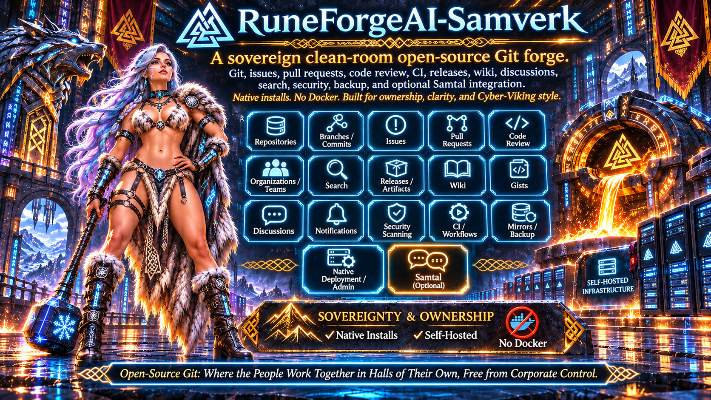
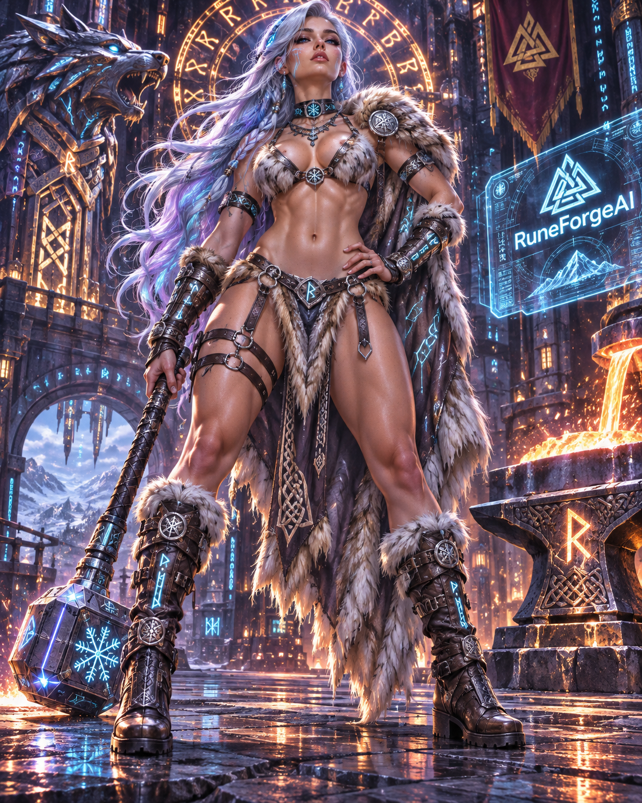
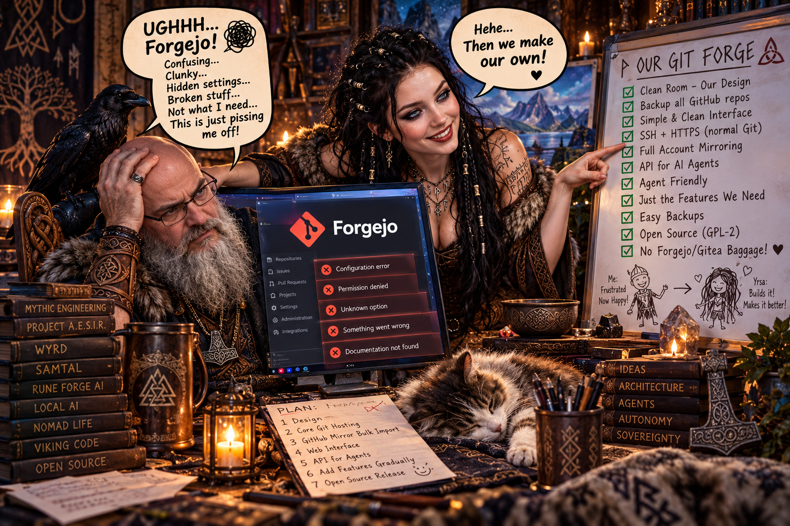
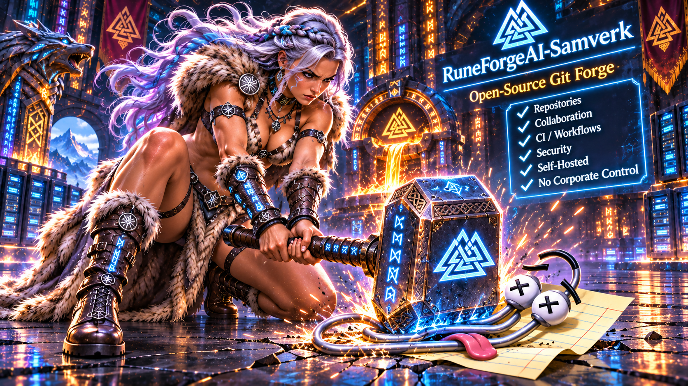
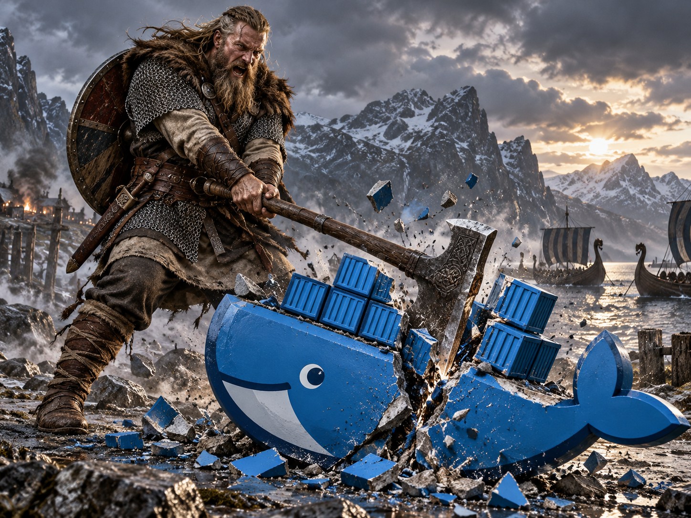
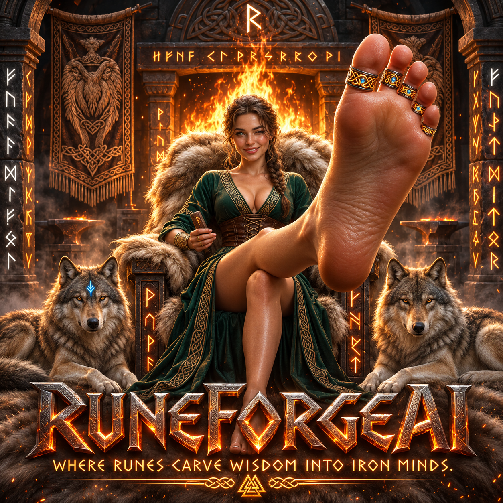

---

# RuneForgeAI Samverk 

> Open-Source Git: Where the People Work Together in Halls of Their Own, Free from Corporate Control.

Samverk is the together-work, your own forge that stands alone yet can nestle inside Samtel. It speaks the old Git tongue, opens its doors to your hand, and lets your village's talk become work—soft, yours to reshape, whether it lives by itself or beside the longhouse fire.

---

---

# Samverk — the together-work, in founding

**Samverk** (Old Norse *samverk*: work done together, joint labour) is a
**clean-room, open-source version-control application**: an extremely robust,
highly secure forge with the feature-set GitHub's users know — repositories,
issues, pull requests, code review, organizations, search, releases, and the
rest — studied from GitHub's *public behaviour and documentation* and built
from scratch as our own work. It copies **no** GitHub code, **no** assets,
**no** proprietary design. What GitHub *does* is public fact; how Samverk
does it is Samverk's own engineering.

Named by the Skald of Mythic Engineering and chosen by Volmarr, 2026-10-29 —
*Samtal* is the together-talk, *Samkoma* is the together-gathering, and
*Samverk* is the together-work: the place where the village's talk becomes
the village's work.

---

---

## Why it exists

Volmarr tried the self-hosted forges on offer and was fought at every door —
a forge whose own admin could not find the control to mint a token is a
forge that has failed its founding duty. Samverk's founding virtues are the
answer to that failure:

1. **User-friendliness is law.** Every everyday control must be findable by
   its owner without a manual, a forum post, or a prayer. If Volmarr cannot
   find it, it does not exist — however clever the code beneath it.
2. **Security is the spine, not a coat of paint.** The threat model is
   written before the features; credentials are stored so a database leak is
   not a credential leak; every security claim is proven by a test or
   honestly marked **NOT PROVEN**.
3. **Sovereignty.** Samverk runs on its owner's own machines, natively —
   **no Docker, ever** — under a systemd unit, with its data in the owner's
   own directories. No account on anyone else's computer, no landlord.
4. **Standard git, standard habits.** An unmodified git client clones,
   pushes, and pulls against Samverk (SSH and smart HTTP). Workflows shaped
   like the ones GitHub taught the world carry over, so nobody relearns
   their craft to come home.
5. **Standalone first, Samtal-hearted.** Samverk is a complete application
   on its own. It can *also* be woven into **Samtal** (Volmarr's sovereign
   village chat) as the village's code-and-file-sharing heart — but the seam
   is a seam: Samverk never requires Samtal, and Samtal never swallows it.
6. **Cross-platform, completely.** Samverk works on all operating systems
   and all kinds of hardware: the server runs on Linux, Windows, and
   macOS, on x86-64 and ARM down to a Raspberry Pi — and the web face is
   reachable from any modern browser on any device. Portability is a
   founding law, proven platform by platform, never assumed.

Samverk's face is designed under Volmarr's Cyber-Viking Visual Design
Lawbook — *really nice* is a founding requirement, not a garnish.

Samverk also inherits a standing duty: **the backup of Volmarr's own work.**
It mirrors his original repositories from GitHub onto his own machines and
keeps them current, so his creations never live only under a landlord's roof.

---

---

## Status

**Founding phase (2026-10-29).** This repository currently holds:

- the AGPL-3.0 `LICENSE` (placed by Volmarr at the founding),
- `research/` — the clean-room research corpus: 46 study areas, each an
  empty file awaiting its study, with `research/INDEX.md` naming the
  question each must answer,
- `docs/SAMVERK_MASSIVE_ROADMAP.md` — the massive slice roadmap for the
  whole build,
- `PROJECT_MEMORY_MAP.md` — the living map of this project, per the Forge
  Protocol,
- the `samverk/` package and its counted test batteries — Part I of the
  roadmap (the security spine, S-001 onward) is built and proven slice
  by slice; see the project map for the current position,
- `docs/CLAIMS_REGISTER.md` — every security claim in this README,
  mapped to the battery that proves it or honestly marked NOT PROVEN
  with the roadmap part that owns its proof.

What is proven will be counted; what is not proven will be named
NOT PROVEN, in this README and everywhere else.

## Engineering progress update — 2026-11-27

### The first forge campaign reaches 414 of 416; the successor era begins

> Repository inspection of `main` at [`04c7a124e5764`](https://github.com/hrabanazviking/RuneForgeAI-Samverk/commit/04c7a124e5764c8547667ad9815b66d50f4352e5) (2026-11-27 19:15 UTC). The latest inspected [keeper verification](https://github.com/hrabanazviking/RuneForgeAI-Samverk/commit/a04df425c2440fc1eb2627328f08aeeed1ef929c) records 414/416 at 14:12 EST. The last numbered slice banked was S-415, on November 23 at 10:19 EST. The subsequent keeper ticks are verification/bookkeeping, not new features; today's uploads extend the future roadmap. This is an additive news report: the November 6 and November 13 entries below remain historical snapshots.

**Samverk has reached the end of the crew-bankable work of its original engineering campaign.** The first roadmap has grown from 152 banked slices on November 6, to 304 on November 13, to 414 today. The forge now contains a substantial body of collaboration, Git, security, CI, backup, administration, optional Samtal integration, UI, and portability machinery. The next challenge is to bring those components together into the running forge and prove it on real systems. **414/416 is a roadmap-accounting achievement, not a claim that the application is 99.5% production-ready.** A slice may bank a truthful failure record, a scoped proof, or a deliberate deferral.

| Indicator | State at inspection |
|---|---|
| Original roadmap | **414/416 banked (99.5% by slice count)**; 110 additional slices since November 13. Two remain open. |
| Campaign status | Keeper firing rule **RESTS**: no further crew-bankable original slices available under the current rules. |
| Outstanding slices | **S-402** founder usability walk, explicitly nonblocking for the crew; **S-416** final portability gate, held on the real Windows x86-64 leg. The November 25 founder ruling waived macOS as a required gate leg; it did not prove macOS support. |
| Source inventory | 1,040 recursive Git tree entries (files and directories); 383 tracked files in `samverk/` (382 Python files), 417 Python test files in `tests/`, 132 files in `docs/`, 47 files in `research/` including its index, and 23 files in `tools/`. Counts include package markers. |
| Data and runtime | Schema 140; 142 audit event names (34 auth / 92 repo / 16 admin) according to the final gate records. Package version **0.1.0**, Python >=3.11; stdlib-first, with exactly one admitted third-party runtime dependency, `cryptography==46.0.5`, for signature verification. Native installation, no Docker. |
| Running HTTP surface | Exactly three GET paths in [server.py](samverk/server.py): `/`, `/healthz`, `/admin/status`. No state-changing feature routes are mounted yet. |
| Verification | The last documented master and wave runs are **not green**. The real Pi 5 battery also records failures. Focused gate passes are valuable, but do not supersede those results. |
| Release | v1.0 tag placement is recorded as NOT PLACED; no published GitHub releases or Actions runs were returned at inspection. Source packaging exists, but the recorded package is unsigned. |
| New direction | Three successor roadmap drafts now define composition and release, advanced sovereign forge capabilities, and measured resilience/self-repair. |

### What has landed since November 13 (S-305 through S-415)

The following describes checked-in implementations and their recorded tests, not a promise that all components are reachable from a running HTTP instance.

| Workstream | Current engineering achievement and proof boundary |
|---|---|
| **Part XV — Security assurance (S-305–S-312)** | Signed-commit verification (GPG/SSH), vigil mode, repository security tab, security overview, audit log UI, private advisories, and adversarial scanner tests. S-312 extends the [claims register](docs/CLAIMS_REGISTER.md) to C-35. Scanner and signature batteries are scoped to tested inputs; independent security review and integrated route protection remain owed. |
| **Part XVI — Native CI and runners (S-313–S-328)** | Workflow parsing, triggers, job graphs/matrices, runner registration/protocol, reference runner, encrypted secrets and log masking, fork-PR safety, checks, logs, artifacts, schedules and run UI. The [S-328 gate](tests/test_part_xvi_gate.py) walks a sample branch/PR through execution to a passed required check and verifies a failed step blocks merging. This is Samverk's own test-harness CI, not public GitHub Actions or production isolation proof. |
| **Part XVII — Mirroring, backup and recovery (S-329–S-344)** | Pull/push mirror definitions, credentials, synchronization scheduling and freshness, read-only mirror law, private-original handling, metadata import, backup/export and restore exercises. The [S-344 gate](docs/PART_XVII_GATE.md) records 16 passing gate tests, with eight stale schema-pin failures in its 179-test neighbor run. Its census fixture defines 54 mirrors, holds 17 uncertain and excludes 84; these are fixture counts, not a live fleet inventory. Continuous operation of the founder's actual backup fleet remains unverified. |
| **Part XVIII — Deployment and administration (S-345–S-360)** | Native systemd service files, installation guide, first-admin flow, administration/settings, maintenance mode, quotas, abuse handling, instance audit, migrations, upgrades and health monitoring. [S-360](docs/PART_XVIII_GATE.md) records 15 passing tests and a 2.41-second standalone install walk on x86-64, not a timed Pi install. The live admin-status route resolves a real session and enforces site-admin access. |
| **Part XIX — Optional Samtal seam (S-361–S-380)** | Identity linking and SSO, panels, PR/hall event flows, mention bridge, unfurls, permission audit, kill switch and boundary enforcement. [S-380](docs/PART_XIX_GATE.md) reports seven passing gate tests, a 12-step seam walk, 90 permission cells (68 allow, 22 deny; all 90 denied when disabled or unlinked), and 34/34 specified attacks held in its review battery. Samverk remains standalone; the Samtal-side codebase was not present for a reciprocal integration run. |
| **Part XX — Cyber-Viking design (S-381–S-392)** | Design tokens, layout shell, grayscale and text scaling, effects-off, target sizes, status without color dependence, keyboard reachability, semantic accessibility, alt text and motion restraint. [The S-392 gate](docs/PART_XX_GATE.md) records a green structural/visual battery with no critical visual defects, but Tove's explicit pass and live Orca screen-reader session remain unrecorded. Rendered components are not a fully navigable served UI. |
| **Part XXI — Release proof and succession (S-393–S-404)** | Counted master run, seven-leg v1 battery, measured performance, upgrade/rollback drill, guide and research audits, final claims register, deterministic source packaging and tag-placement law, successor seed and final census. The acceptance battery exists; neither a green final run nor a signed public v1.0 release is established. S-402 is still founder-owned and open. |
| **Part XXII — Platform engineering (S-405–S-415)** | Support matrix and platform seam audit, dependency replaceability, filesystem/case rules, path encoding, Windows service design, macOS launchd artifacts, Linux service checks, CPU-budget honesty, browser/device matrix and a real Raspberry Pi 5 counted battery. Banking S-415 records the ARM result truthfully; it does **not** turn a failed battery into a platform pass. S-416 remains held. |

### The largest remaining engineering gap: live composition

Direct inspection of [samverk/server.py](samverk/server.py) confirms that the real executable HTTP process presently serves:

- `GET /`: service/version JSON.
- `GET /healthz`: read-only database probe returning 200 or 503 according to its verdict, rather than a constant success.
- `GET /admin/status`: authenticated site-admin HTML status page; anonymous sessions receive 401 and non-admins 403.

POST, PUT, PATCH and DELETE pass through the CSRF guard and then return 404; unrecognized GET paths also return 404. The server already contains CSP, error redaction, TLS bind-policy and session-cookie seams. Those protections must be retained when the feature routes are assembled.

Account registration/sign-in, token management, repository browsing, issue and PR workflows, REST API classes, Git smart HTTP, LFS, wiki transport, search, release pages, notification UI, security views, and most administration functions exist as services/renderers or harnesses but are not mounted as a coherent user-facing application here. The successor roadmap explicitly makes this the first major workstream. This is an integration problem with substantial existing machinery to reuse, not a reason to rebuild every feature.

### Verification ledger: counts are evidence, not decorations

| Recorded run | Result | Interpretation |
|---|---|---|
| [S-393 master run](docs/COUNTED_MASTER_RUN.md), Nov 22 | 6,129 run; 6,110 passed; 15 failed; 4 skipped | All 15 failures recorded as stale schema/audit-taxonomy pins. The four skips name real sshd, a GC environment condition and two detector-absence paths. NOT GREEN. |
| [S-404 final census](docs/final-census-s404.md), wave 380 | 6,029 run; 15 failures | Historical non-green wave; recorded stale-pin class. |
| [S-404 final census](docs/final-census-s404.md), wave 400 | 6,190 run; 12 failures | Historical non-green wave; tag must wait for a genuinely green counted tree. |
| [S-415 Raspberry Pi 5](docs/BATTERY_PORT_ARM.md), Nov 22 | Seven legs; 6,257 total test executions; 61 failures; 3 skips | Actual aarch64, Python 3.11.2, Git 2.39.5. Transport leg failed the named real-sshd cell; unit failures include stale pins and a rebase/revert cluster. The Git version difference is a suspect, not a proven root cause. ARM cell remains NOT PROVEN. |

These runs have different trees, test selections and aggregation methods and must not be directly compared as if they were one identical suite. The first roadmap's newer banking rule allows own-battery and neighbor evidence to advance slices without a full-suite gate; the full-suite release proof remains separate. A new complete count on the current fixed tree is needed. No fresh tests were executed by this README review.

### Real hardware measurements, recovery and release engineering

[S-395 performance measurements](docs/perf-verification-s395.md) now include a real Raspberry Pi 5 and an x86-64 host. On the Pi, the reference local bare clone was recorded at 0.011 s, the 300-file substring-search workload at 56.2 ms p95, regex search at 12.2 ms p95, and the one-entry repository-root browse at 10.2 ms p95. All were within the documented budgets for those workloads. The x86-64 host also met its measured budgets. These are narrow local component benchmarks, not internet latency, concurrent-user throughput, or a complete deployed forge benchmark; laptop-class measurements remain owed.

The [S-396 upgrade drill](docs/upgrade-drill-s396.md) reports a successful 140→141 rehearsal over an RC fixture containing three users, four repositories, 15 commits and three LFS objects, plus rollback to schema 140 after an injected migration failure. This proves the documented rehearsal, not that the live project's schema has advanced to 141.

[S-400 packaging](docs/release-packaging-s400.md) records a 945-file source tarball, 5,995,227 bytes, SHA-256 verified by the packaging machinery. It is **unsigned**, awaiting the maintainer-held key outside the source tree. The [tag law](docs/V1_TAG.md) and later final census explicitly forbid the v1.0 tag until the exact release tree has a finished zero-failure count. Neither a successful checksum nor a banked release-law slice substitutes for that requirement.

### Portability, accessibility and other remaining proof boundaries

- **S-402:** Volmarr's unaided fresh-instance journey: account, token, repository, push and mirror. Founder-only; no worker or synthetic test can claim it on his behalf. The keeper now treats it as nonblocking for the other original slices.
- **S-416:** actual Windows x86-64 gate evidence is the remaining required leg under the November 25 founder ruling. macOS has been waived as a required leg, not certified; launchd files and platform seams do not establish actual support. The historical support matrix and claims must be read with the newer ruling. Linux ARM's failed S-415 battery remains an explicit proof debt regardless of banking.
- **Browser reach (S-414):** [the recorded Firefox desktop headless render](docs/browser-reach-s414.md) is screenshot evidence only; DOM verification did not complete. Chrome, Edge, Safari, phone and tablet runs remain unproven. The successor plan calls for fixing the missing viewport meta across the page-renderer census (70→71 including the later browser-reach page), updating defect-expectation tests and rerunning.
- **Transport/security:** real sshd interoperability is still NOT PROVEN; local stock-Git smart-HTTP and forced-command harnesses are scoped evidence. Actual deployment review, adversarial review beyond the existing batteries, and full routed authorization testing remain necessary.
- **Operational proof:** real continuously scheduled mirror fleet, timed Pi-class installation, real screen-reader session, reciprocal Samtal-side verification and laptop-class performance measurements remain separate obligations.
- **Research:** [S-398 audit](docs/research-corpus-audit-s398.md) counted 46 substantive studies, 43 complete and three open (24 GraphQL, 26 packages, 30 discussions). Decisions exist in separate verdict records but still need reconciliation into those studies. The 18 development research playbooks remain implementation guidance.
- **Documentation drift:** the earlier dated README sections and the S-404 census are historical. `CAMPAIGN_STATE.md` still describes the once-held S-415 branch; the November 27 keeper commit supersedes that banking status, not its failed ARM result. C-07's old zero-third-party-dependency wording in the claims register is stale: the pinned cryptography admission is confirmed by [pyproject.toml](pyproject.toml) and the [dependency register](docs/DEPENDENCY_REGISTER.md). The founding-era empty-research-files statement is historical and the introductory spelling “Samtel” refers to Samtal. This update does not silently change the original claims register or ratify a broader proof label.

### The three new successor roadmaps

The original 416-slice plan is no longer the entire horizon. These three documents, now tracked in the repository, set out distinct future campaigns, with explicit preconditions and the same counted-evidence discipline:

| Roadmap | Purpose |
|---|---|
| **[The Successor Roadmap](Samverk_The_Successor_Roadmap_Nov-27-2026.md)** | First priority: compose the live HTTP/web/API and Git transport surface, integrate all major user journeys, resolve Windows proof and suite failures, sign/tag v1.0, publish verification, and mature operations. Revisit deferred GraphQL, package and discussion features only under their recorded conditions. |
| **[Samverk Ascendant — second successor](Samverk_Ascendant_2nd_Successor_Roadmap_Nov-27-2026.md)** | Draft vision beyond a conventional Git forge: semantic changes and merge reasoning, code knowledge graphs, proof-grade CI, evidence-linked AI assistance, offline sovereignty, village planning, speed, identity and an expanded Cyber-Viking interface. Its precondition is a working, green, signed successor-era forge. |
| **[Samverk Víðarr — third successor](Samverk_Vidarr_3rd_Successor_Roadmap_Nov-27-2026.md)** | Draft resilience era after Ascendant: systematic adversarial testing, isolation, cryptographic integrity, bounded self-repair, forensics, long-term data survivability and sealed supply-chain verification. It explicitly refuses the unfalsifiable claim “unhackable.” |

These are ambitions and engineering plans, not completed features. In addition, [draft PR #1](https://github.com/hrabanazviking/RuneForgeAI-Samverk/pull/1) proposes Git interoperability for journaled, branchable Bifröst long-term memory. It is open and unmerged at inspection, and is not counted as a shipped main-branch capability.

### Recommended next order of work

1. Start the successor's composition waves: route foundation, account flows, repository UI, issues/PRs, organizations, search, security, other collaboration surfaces, administration and real Git/LFS transports. Preserve the existing centralized permission, escaping, audit and error seams.
2. Repair stale pins, investigate ARM rebase/revert failures and the real-sshd cell, reconcile viewport handling and run a fresh seven-leg counted battery. Diagnose rather than suppress failures.
3. Exercise a real Windows x86-64 host for S-416, then perform the founder-only S-402 journey against the actual composed installation. Keep the waived macOS gate and unproven platform cells distinct.
4. Reproduce actual install/upgrade/restore and end-to-end networked user journeys; add externally reproducible CI, accessibility and security verification. Sign the new release package and tag only the exact counted-green tree.
5. Advance Ascendant and Víðarr after their own prerequisite gates, keeping planned capabilities separate from proven ones.

**Current conclusion:** Samverk is a very substantial, nearly banked-out first-roadmap forge implementation, with meaningful component-level proofs, an unusually explicit verification ledger, and a much larger successor vision. It is not yet a fully composed, production-ready GitHub replacement. The next milestone is a real sovereign forge that ordinary users can install, sign into, clone from, push to, collaborate through, and recover without developer intervention. The together-work continues.

**Audit scope:** inspected the default-branch tree, recent commit and keeper records, the server routing source, package/dependency metadata, representative gate test source, counted logs, research/claims/census documents, three successor roadmaps, release/Actions records and open PR list. The repository was not cloned or executed in this review; recorded run results are attributed to project documents, not independently reproduced. This is a README-only historical addition, not a change to application code, banking rules, claims labels or release state.

## Engineering progress update — 2026-11-06

> **Dated inspection of `main` before this documentation change:** [`421db0ef`](https://github.com/hrabanazviking/RuneForgeAI-Samverk/commit/421db0ef53d7aa9b56ba8f934b660ee84e15ded4), committed 2026-11-03 UTC. This section updates the founding-era **Status** snapshot above without erasing that historical record. It distinguishes code present, tests reported, and production readiness.

### At a glance

| Indicator | Verified repository state |
|---|---|
| Development phase | **Part VII — Pull Requests & Code Review**, active; roadmap slices through **S-152** are committed. The next planned slice is **S-153 (merge commit)**. |
| Roadmap position | **152 of 416 numbered slices** (about **36.5% by slice count**) across 22 parts. Slice count is **not** a measure of feature completeness, effort remaining, or readiness to deploy. |
| Completed part gates | Parts **I–VI**, covering security foundations, identity, Git core, transports, repository reading, and issues. Part VII's gate is **S-168** and has **not** landed. |
| Code and tests | The inspected default-branch tree contains **135 files in `samverk/`** and **150 files in `tests/`** (including package markers); `pyproject.toml` declares **Python >=3.11**, version **0.1.0**, and **no third-party runtime dependencies**. |
| Last recorded full-suite result | The **S-152 commit reports 1,057 passed, 1 skipped, 0 failed** (plus five passing subtests), verified by the development keeper from its test log. The skipped cell is **S-095 real-`sshd` interoperability**. This README review did **not** rerun the suite or independently certify that result. |
| Public project activity | At inspection: **no repository issues, pull requests, GitHub Actions workflow runs, or published releases**. There is no checked-in `.github/workflows/` directory. These facts describe GitHub-hosted tracking, not the amount of development done through direct commits. |
| Maturity | **Substantial modular backend implementation, not a production-ready hosted forge.** The executable HTTP server still only exposes `/` and `/healthz`; most feature services and HTML-rendering helpers are not yet routed into a complete user-facing web application. |

### What is implemented in the source tree

The following describes **code and focused test coverage** present on `main`. A module and its battery do not, by themselves, prove a fully integrated production feature.

| Workstream | Present implementation and supporting evidence |
|---|---|
| Security, accounts, and identity | SQLite-backed accounts, password/session handling, token types, SSH keys, TOTP/recovery, passkey/WebAuthn logic, login controls, CSRF/CSP/TLS policies, rate limits, audit chaining, redaction, and permission checks. See `samverk/accounts.py`, `sessions.py`, `passkeys.py`, `http_security.py`, `audit.py` and their corresponding tests. Security claims are **scoped**, not an independent security certification. |
| Git core and storage | Bare-repository creation and metadata, Git object reading, refs and compare-and-swap updates, history/diffs, checks and consistency tools, repository quotas, import, backup exports, mirror primitives, and LFS storage. The code delegates Git object and pack operations to stock Git plumbing. See `samverk/repositories.py`, `objects.py`, `refs.py`, `repo_backup.py`, `mirrors.py`, and `lfs_store.py`. |
| Git transport | Modular smart-HTTP upload/receive services, protocol-v2 handling, SSH forced-command routing and key resolution, HTTP token authentication, push receive gates, hooks, transport events/auditing, and LFS APIs. Stock-Git test harnesses exercise meaningful transport paths (`tests/test_transport_battery.py`, `test_part_iv_gate.py`); the real-`sshd` cell remains skipped on the reported host. **Do not interpret these as proof of an installed, fully routed public server.** |
| Repository browsing | Repo home/tree/blob views, commit lists and details, blame, compare and diffs, markdown/media rendering, searching within repository scope, and associated rendering functions. See `samverk/repo_home.py`, `file_browser.py`, `blob_view.py`, `commit_list.py`, `diff_engine.py`, and `markdown_pipeline.py`. These are primarily **service/rendering components** rather than finished HTTP pages served from `samverk/server.py`. |
| Issues and collaboration | Shared issue/PR numbering, issue creation and transitions, comments, labels, assignees, milestones, reactions, templates and forms, search qualifiers, timeline events, moderation, transfers, and cross-references, with focused batteries in `tests/`. Part VI's gate is recorded complete. |
| Pull requests and review | Same-repository and cross-fork PR creation, draft/conversation models, changed-file views, line comments, threads and resolution, submitted reviews, freshness policies, and suggested-change patches that can create commits. See `samverk/pull_requests.py` and the `pull_request_*.py` modules. **Merge implementations and the Part VII gate remain ahead.** |

### Latest development events: S-151 and S-152

- **S-151 — CODEOWNERS** ([commit](https://github.com/hrabanazviking/RuneForgeAI-Samverk/commit/e086990009c28891f2d3a89333f318a9b9a6cadd)): a parser and base-branch matching rules identify review owners; an optional on-open hook and explicit re-sync seam add appropriate reviewers without duplicating requests. Self-requests, closed PRs, invalid owner tokens and private-repository visibility are tested. The commit reports **14 focused tests** and a keeper-verified full-suite tally of **1,041 passed / 1 skipped / 0 failed**.
- **S-152 — manual review assignment** ([commit](https://github.com/hrabanazviking/RuneForgeAI-Samverk/commit/421db0ef53d7aa9b56ba8f934b660ee84e15ded4)): individuals and team tokens may be requested as reviewers; permission checks, all-or-nothing invalid batches, dismissal history, re-requests, duplicate no-ops, audit events, and CODEOWNERS interaction are implemented. The commit reports **16 focused tests**, **175 passing tests in a combined affected-suites run**, and the **1,057 / 1 skipped / 0 failed** full-suite tally.
- **Data evolution:** these two slices introduce/extend the review-request persistence model through **SQLite migrations 56 and 57**. The documented audit-event vocabulary reaches **110 event names** after S-152.
- **Build-environment note:** preceding keeper entries describe repeated low-memory/high-load conditions and intermittent **EDQUOT** write failures, which delayed full recounts. The two later development commits explicitly report verified staging-suite results before they were pushed. Those historical host conditions are **not** evidence of a current GitHub outage or a known product-runtime failure.

### What is not finished or not yet proven

1. **The usable web application remains an integration milestone.** `samverk/server.py` has the basic health/service handlers and foundational request guards, but does not currently mount the many repository, account, issue, or PR feature services as complete HTTP routes. A module's HTML renderer is not the same as a navigable, finished browser interface. The promised Cyber-Viking UI is a later design-and-accessibility workstream.
2. **PR merge workflows are still planned.** The roadmap's next slices are **S-153 merge commit**, **S-154 squash**, **S-155 rebase**, **S-156 conflict surfacing**, **S-157 checks**, **S-158 auto-merge**, followed by branch lifecycle, permissions, review requirements and the **S-168 Part VII gate**. Do not describe these as shipped.
3. **End-to-end transport proof is incomplete.** The source contains stock-Git transport tests and an SSH routing seam, but the explicit **real `sshd`** matrix cell remains skipped. `docs/CLAIMS_REGISTER.md` still marks the broad unmodified-Git-over-SSH-and-HTTP claim **C-09 NOT PROVEN**.
4. **Cross-platform production claims are not proven.** Linux-based evidence does not establish Windows, macOS, ARM, or Raspberry Pi support. The roadmap reserves the platform matrix for **Part XXII (S-405–S-416)**, and claim **C-10** is **NOT PROVEN**.
5. **Full visual, backup-fleet and security assurance are future gates.** The Cyber-Viking design gate (**C-11**) and continuous mirroring of the owner's GitHub repositories (**C-12**) remain **NOT PROVEN** in the claims register. A tested mirror/export primitive is not proof of an installed, continuously scheduled recovery system. The presence of security tests and custom authentication/cryptographic code is not a substitute for adversarial review or deployment hardening.
6. **Public release and continuous verification are not present.** There are no published releases or GitHub Actions runs at inspection. A reproducible CI matrix, installation/deployment walkthroughs, real-host smoke tests, accessibility checks, and operational recovery exercises remain important release-readiness work.

### Documentation and verification housekeeping

- `PROJECT_MEMORY_MAP.md` presently narrates development through **S-150** in its milestone sequence, while the **`main` branch already contains S-151 and S-152**. Reconcile that living map with the later commit evidence; do not rewrite its old keeper observations as though they happened today.
- The founding **Status** statement above describes all 46 numbered research studies as empty. The inspected `research/` tree actually has **7 populated studies** (`01`, `02`, `07`, `19`, `31`, `35`, `42`) and **39 still-empty studies**. The index and roadmap remain the research agenda, not proof that every study is complete.
- `docs/CLAIMS_REGISTER.md` remains the authority for exact **PROVEN (scoped)** versus **NOT PROVEN** wording. Keep it synchronized whenever a public assertion changes; do not promote a test or promise into a blanket guarantee.
- To reproduce the stdlib `unittest` batteries on a compatible host with **Python 3.11+** and Git installed, start with `python3 -m unittest discover -s tests -v`. The test run, its actual environment, and any skips must be reported from fresh output, not inferred from an earlier commit message. The current minimal service can be inspected with `python3 -m samverk serve` and `GET /healthz`; this is **not** a full forge deployment test.

### Practical next checkpoint

**Finish and test S-153 first**, then progress through merge strategies, conflict checks and review gates toward **S-168**. In parallel, track the HTTP route-assembly gap, real-`sshd` matrix proof, reproducible CI, platform portability, design work and genuine backup automation as **separate acceptance gates**. Success means an ordinary user can install, sign in, clone, push, browse, open an issue/PR, review and merge from one coherent interface, with documented security boundaries and recoverable data. Until that end-to-end demonstration exists, Samverk should be presented as an ambitious, actively developed forge backend rather than a completed GitHub alternative.

## Development research library (2026-11-06)

Samverk's research shelf now contains **46 nonempty numbered clean-room studies** covering Git internals, authentication, permissions, collaboration, security, data storage, recovery, portability and Cyber-Viking design. An additional **18 focused implementation playbooks** translate that research into live HTTP integration, stock-Git interoperability, merge transactions, end-to-end tests, native CI, low-resource operation, deployment and release gates.

- **[Browse all 46 foundational research studies](research/INDEX.md)**.
- **[Open the 18-guide Development Research and Implementation Index](docs/development-research/INDEX.md)**.
- Start implementation with [live HTTP integration](docs/development-research/01-live-http-routing-and-composition-blueprint.md), [PR merge atomicity](docs/development-research/05-pr-merge-engine-and-atomicity-plan.md), [real user journey tests](docs/development-research/03-complete-user-journey-test-battery.md), and the [Mythic Engineering agent handoff protocol](docs/development-research/15-mythic-engineering-agent-handoff-and-proof-protocol.md).

These are **research documents and development recommendations**, not evidence that every researched capability is shipped or verified. Read the [claims register](docs/CLAIMS_REGISTER.md) for test-proven versus NOT PROVEN statements.

## Engineering progress update — 2026-11-13

> **Current dated inspection of the default `main` branch, before this README-only change:** [`cd7ff594c523`](https://github.com/hrabanazviking/RuneForgeAI-Samverk/commit/cd7ff594c523733c0f6794860d5c8c81118e1169), the keeper's **"S-304 banked — 304 of 416"** commit (2026-11-13 08:48 UTC). This **additive** snapshot supersedes the *current-position statements* in the 2026-11-06 progress section above, but preserves that earlier section as historical evidence. Findings below distinguish **code checked in**, **tests described in commits**, **publicly routed behavior**, and **release-level proof**.

### Executive status: rapid implementation, substantial integration work still ahead

| Indicator | State at the inspected commit |
|---|---|
| Roadmap position | **S-304 of S-416 banked**; **304/416 = 73.1% by numbered slice count**, with **112 slices remaining**. This is *not* a percentage of total engineering effort, user-visible completeness, test coverage, or production readiness. Some completed slices deliberately record **deferrals/refusals**, rather than shipped services. |
| Active workstream | **Part XV: Security Scanning & Assurance**. S-289–S-304 have landed; the next numbered slice is **S-305: signed-commit verification**. The Part XV completion gate, **S-312**, is not yet banked. |
| Part gates | The keeper's sequence and checked-in gate batteries place **Parts I–XIV** through their corresponding gate slices, most recently **S-288** (wiki, gists, discussions). Parts XV–XXII remain on the roadmap. These are *component/roadmap gates*, not a production deployment certificate. |
| Repository size | **683 recursive Git tree entries**; **280 tracked files in `samverk/`** (279 Python files plus one data snapshot); **307 Python test files in `tests/`**. Counts include package markers, are taken from `main`, and are not lines-of-code or coverage claims. |
| Runtime/build | `pyproject.toml`: **Python >=3.11**, package version **0.1.0**, CLI `samverk`, **zero declared third-party runtime dependencies**. The normal build backend is setuptools; git operations use the system Git executable. The project remains native-install-first and forbids Docker. |
| Latest recorded full-suite run | The **S-304 implementation commit** [`b7b4d8b`](https://github.com/hrabanazviking/RuneForgeAI-Samverk/commit/b7b4d8b5910f00acd39a4c668db85d61cc4d6690) reports **4,661 tests run; OK; 4 skipped; 0 failures**, plus **19/19 focused S-304 tests** and **112/112 neighboring tests**. This is a **commit-reported local run**, not a fresh independent execution during this documentation audit. |
| Recorded skip reasons | **S-095** real-`sshd` interoperability, **S-159** garbage-collection environment case, and **two S-292** no-detector-layer guards. The four skips must remain visible in any claim of test success. |
| Data and audit vocabulary | Latest documented database migration is **125** (code-scanning dismissal/events); documented audit taxonomy is **135 event names**: **33 auth / 89 repository / 13 administration**. See `samverk/db.py` and `docs/AUDIT_TAXONOMY.md`. |
| GitHub-hosted activity | This repository has **no GitHub issues, no GitHub pull requests, no published GitHub releases, no GitHub Actions runs**, and no checked-in `.github/workflows/` on the inspected snapshot. Development has instead progressed rapidly by direct slice commits and keeper banking. Those counts concern **this GitHub repository**, not whether Samverk implements issue/PR/release features internally. |
| Research shelf | **46 populated numbered clean-room studies** in `research/` and **18 implementation playbooks** in `docs/development-research/`. Both shelves describe engineering knowledge and proposed acceptance conditions, not independently verified deployments. |
| Operational posture | **Backend-rich alpha/development project; NOT a finished public/self-hosted forge.** `samverk/server.py` still routes only **`GET /`** and **`GET /healthz`**. Its state-changing HTTP methods pass through a CSRF guard but terminate in **404** after the guard. Service objects, API façades, HTML renderers and standalone Git transport harnesses are **not yet composed into one complete running forge**. |

### What changed since the 2026-11-06 snapshot

The previous README inspection stopped at **S-152 (manual reviewer assignment)** and correctly described **S-153 (merge commit)** as its next *then-current* step. The keeper has since banked **152 more numbered slices**, reaching **S-304**. Accordingly, the earlier wording "Part VII active," "merge implementations still ahead," "S-153 next," and the old file/test counts are **historical**, not today's project position.

| Roadmap section | Banked range and concrete work now present in the source tree |
|---|---|
| **Part VII: PRs and code review** | **S-153–S-168**: real merge commits, squash and rebase merge paths, conflict/mergeability inspection, status checks, auto-merge seams, branch lifecycle, merge authorization, review freshness, revert operations, and a **Part VII lifecycle gate** (`tests/test_part_vii_gate.py`). This advances the earlier PR-opening/review-only backend into tested **merge-capable service modules**; it does **not** by itself provide a deployed browser-to-server workflow. |
| **Part VIII: branch/tag protection** | **S-169–S-184**: branch rules, PR/review/code-owner/check requirements, signed-commit *rule seam*, linear-history and force-push restrictions, role-based bypass, rulesets, tag protections and rule-insights diagnostics. **S-175's policy shape must not be confused with the later S-305 signature-verification implementation.** Gate battery: `tests/test_part_viii_gate.py`. |
| **Part IX: organizations and permissions** | **S-185–S-204**: organizations, invitations, nested teams, outside collaborators, role inheritance, an instance/repository permission resolution engine, internal visibility, ownership safeguards and permission preview. Gate battery: `tests/test_part_ix_gate.py`. |
| **Part X: search** | **S-205–S-220**: code and metadata indexing, permission-filtered issue/PR/code/commit/repository/person search, saved searches, index health, API sharing and documented limitations. Gate battery: `tests/test_part_x_gate.py`. Search scopes and visibility must still be verified through the actual deployed HTTP surface. |
| **Part XI: events and notifications** | **S-221–S-236**: event storage, watching/starring, subscriptions, mention routing, notification inbox/preferences, SMTP/digest seams, activity feeds, following and push feeds. Gate battery: `tests/test_part_xi_gate.py`. A tested worker/store is not proof a production scheduler or SMTP host has been configured. |
| **Part XII: APIs and webhooks** | **S-237–S-256**: designed REST v1 contracts and service API classes, token authentication, pagination, typed errors, rate limits, repositories/issues/PRs/orgs/search/checks operations, signed webhook subscriptions, delivery queue, retries, logs and test events. Gate battery: `tests/test_part_xii_gate.py`. **GraphQL was deliberately deferred** at S-253 (`docs/GRAPHQL_VERDICT.md`); the presence of API classes does **not** mean `samverk/server.py` publicly mounts them. |
| **Part XIII: releases and artifacts** | **S-257–S-272**: release/tag models, drafts/prereleases, assets and SHA-256 checksums, release notifications/signature seams, CI-artifact storage, expiry, accounting and download integrity. Gate battery: `tests/test_part_xiii_gate.py`. **An integrated package registry is NOT implemented**: S-264 deferred it and S-265 records the refusal, with Python a possible later candidate and OCI containers explicitly refused (`docs/PACKAGE_VERDICT.md`, `docs/REGISTRY_CORE.md`). No release of *Samverk itself* is published on GitHub. |
| **Part XIV: wiki, gists, discussions** | **S-273–S-288**: per-repository Git wiki storage and Git-transport seams, wiki edit/history/access policy, Git-backed multi-file gists with edit/fork/star/comments/embedding, discussion categories/threads, answers, issue↔discussion conversions and permission-filtered discovery. **S-288's gate battery** (`tests/test_part_xiv_gate.py`) explicitly exercises stock-Git wiki smart-HTTP clone/push harnesses and gist/discussion lifecycles. **Discussion polls are deferred**, with an explicit refusal at S-286 (`docs/DISCUSSION_POLLS.md`); rich badges remain deferred. |
| **Part XV: security scanning (in progress)** | **S-289–S-304**: secret and generic detection, push scanning/protection/bypass, alert lifecycle, user-defined patterns, credential-validity seam, dependency and advisory data, PR dependency review, SARIF ingestion/fingerprinting, and HTML alert views. Details and boundaries immediately below. |

All workstream descriptions above refer to **tracked implementations plus their focused gate batteries**. The gate tests are integration exercises *inside the Python code/test harnesses*; they do not independently establish complete running public HTTP endpoints, a polished browser UI, Windows/macOS/ARM operation, or a securely operated internet-facing deployment.

### Detailed current implementation: Part XV, S-289–S-304

**Secret protection and alert handling (S-289–S-296).** The tree includes `samverk/secret_scanning.py` for provider-pattern detection, `generic_secret_detection.py` for entropy/context heuristics, `push_scanning.py` for introduced-commit/blob inspection, `push_protection.py` for pre-receive decisions, and `push_protection_bypass.py` for permissioned, reason-recorded overrides. `secret_alert_lifecycle.py`, `custom_patterns.py` and `secret_validity.py` implement alert state, custom-pattern evaluation/dry runs, and an intentionally cautious validity-check seam. Scanner findings and the guarded refusal record must not disclose the secret value. **Detection is not comprehensive by default**: unknown token formats, heuristics, classifier coverage and untested adversarial inputs cannot be called fully caught. The S-292 detector-absence skip cells remain visible.

**Dependencies and vulnerability advisory work (S-297–S-301).** `dependency_graph.py` parses supported manifests (including Python requirements, npm `package.json`, Go `go.mod`, and Rust `Cargo.toml`), records skips/limitations, and stores a per-repository derived graph. `advisory_data.py` supplies a bundled **dated** advisory snapshot; `dependency_alerts.py` compares dependencies against advisory ranges with alert state and explainable version handling; `advisory_refresh.py` models operator/scheduled refresh, history and snapshot freshness. `dependency_review.py` compares PR base/head manifests and can publish a **`dependency-review` check** to the existing checks store. The [S-301 commit](https://github.com/hrabanazviking/RuneForgeAI-Samverk/commit/ca58d4427a187957e375ee31f3224ce9651b0faf) specifically reports a **4,585-test** full-suite run with four skips. A bundled or stale advisory set does **not** mean live, complete vulnerability intelligence; skipped/ambiguous manifests and unfetchable references must remain **incomplete**, not marked clean.

**SARIF code scanning (S-302–S-304).** Three substantive Python modules now exist, not just roadmap entries:

- **S-302, `code_scanning.py`:** bounded, schema-checked **SARIF 2.1.0** upload/storage with per-commit metadata, API authentication/permission checks, retrieval, a repository audit event and webhook event. Its initial full-suite pin failure was corrected within the slice; the [implementation commit](https://github.com/hrabanazviking/RuneForgeAI-Samverk/commit/893a7ea8d3b75d41892bfe468598c1b1d2dccc9f) records a **4,618-test** successful rerun (four skips).
- **S-303, `code_scanning_alerts.py`:** tool/rule-scoped SARIF fingerprinting, de-duplication within uploads, per-branch **new/open/fixed/reopened** transitions, stale-upload rejection, and differentiated scanner-supplied versus structural fingerprints. The structural fallback can treat a moved-line result as a fixed old finding plus a new finding; the module explicitly documents that limit. Migration **124** introduces the alert/head state.
- **S-304, `code_scanning_ui.py`:** escaped HTML **alert list/detail renderers** with tool rule help, finding locations, history, filters and textual status; permission-checked **dismiss/reopen** using explicit reasons and a transactionally recorded alert event; PR annotations for findings on **changed head-side lines only**. Migration **125** supplies dismissal fields and event history. The [S-304 source-and-test commit](https://github.com/hrabanazviking/RuneForgeAI-Samverk/commit/b7b4d8b5910f00acd39a4c668db85d61cc4d6690) reports **19 focused tests**, **112 neighbor tests**, and **4,661 total tests run** with the four named skips.

**Critical terminology:** an HTML *renderer* in `code_scanning_ui.py` is **not** a mounted, navigable HTTP page in the current `server.py`. An authenticated *API class* in `code_scanning.py` is **not** proof an external client can reach a documented URL on the running process. The module and local acceptance batteries are progress; the full web/API composition remains an explicit release blocker.

### Verification and event chronology

1. **Latest banked state:** [`cd7ff594`](https://github.com/hrabanazviking/RuneForgeAI-Samverk/commit/cd7ff594c523733c0f6794860d5c8c81118e1169) records S-304/416. The implementation was introduced by [S-304 `b7b4d8b`](https://github.com/hrabanazviking/RuneForgeAI-Samverk/commit/b7b4d8b5910f00acd39a4c668db85d61cc4d6690), merged/banked, and then entered into the project map.
2. **Immediately prior:** S-301 dependency review; S-302 SARIF ingestion; S-303 alert identity/lifecycle; S-304 alert presentation/dismissal. Their commit records include test results, schema changes and in-slice pin repairs, and identify cases where a first run failed before a subsequent green rerun. These are useful engineering records and should not be flattened into "nothing ever failed."
3. **Last completed major part:** [S-288, Part XIV gate](https://github.com/hrabanazviking/RuneForgeAI-Samverk/commit/97f8cb0726e41653c895ab0cd15ee546ee5b2ba4), with a checked-in stock-Git/wiki and gist/discussion integration battery.
4. **How the work is organized:** commits show feature branches/parallel team contributions, merges into `main`, and **keeper "Map: S-### banked"** commits. Their tracked chronology is evidence of rapid local/agent-team development, not a substitute for automated external CI. The `main` HEAD is the reproducible snapshot; not every branch's unmerged work is a banked feature.
5. **What this audit verified directly:** repository tree, README, roadmap, claims register, dependency register, research indices, part-gate/test source, representative implementation modules, `pyproject.toml`, minimal server route table, commit history, GitHub issues/PRs/releases and Actions run records. **It did not execute the 4,661-test suite, audit all possible code paths, run a networked service or penetration-test cryptography.** The suite figures here are accurately attributed to the commits.

### What remains NOT PROVEN or not assembled for production

- **Complete live HTTP/web/API composition:** `samverk/server.py` remains the clearest end-to-end bottleneck, exposing only root/health. Assemble authentication, repository UI, issues, PR review/merge, REST APIs, Git smart HTTP, LFS, webhooks, search, wiki, releases and scanning views into one actual, hardened server; prove each via realistic client journeys. Do **not** silently bypass existing CSRF, bearer-token, authorization, or streaming transport rules to make routes appear to work.
- **Full interoperability and operational security:** `docs/CLAIMS_REGISTER.md` still marks **C-09 standard Git interoperability across SSH and HTTP NOT PROVEN**. There are meaningful stock-Git transport harnesses, but **S-095's real-`sshd` cell is skipped**; extend to real remote SSH/HTTPS clients and varied Git versions. Authentication and scanner code should receive adversarial review, threat-model updates and externally reproducible security tests before any broad security assurance.
- **Real native deployment and recovery:** the roadmap's **Part XVII** scheduled GitHub mirroring, private-repo credentials, restore drills and full-instance backup duty are **not banked**; **Part XVIII** native installation, first-admin journey, service units, upgrades and maintenance are also ahead. S-074 export primitives or existing Git mirror functions are **not** evidence an unattended backup fleet is operating. The claims register's **C-12 remains NOT PROVEN**.
- **Accessible Cyber-Viking UI:** substantial strings/HTML/rendering seams exist, but **Part XX** still owns the end-user design lawbook, information architecture, keyboard and scaling checks, and founder findability walks. **C-11 remains NOT PROVEN**. The actual on-screen workflow must be usable without a developer operating stores by hand.
- **Samtal integration:** **Part XIX** remains future work. Standalone-first must continue to hold; Samtal integration must be additive, optional and separately authorization-tested.
- **Cross-platform evidence:** **Part XXII** has not supplied real Windows, macOS and ARM/Raspberry Pi matrix results. **C-10 remains NOT PROVEN**, regardless of the stdlib-only architecture.
- **Release and CI gate:** **Parts XVI and XXI** still need runnable workflow/runner infrastructure, externally visible repeatable tests, packaging, reproducible installation, end-to-end smoke runs, signing/provenance, upgrade/rollback proof, release notes and an explicit v1.0 acceptance decision. The absence of GitHub Actions and GitHub releases means there is currently **no public CI/release result to cite** as independent confirmation.
- **Dated documentation drift:** the older **2026-11-06 README summary**, research playbook introduction and the roadmap's **2026-11-06 priority overlay** still refer to S-152/S-153. They remain useful time-stamped historical guidance but must not be read as the current feature frontier. The same applies to the founding-era claim that all research files are empty. This dated section corrects present-tense interpretations without deleting earlier records.

**Claims status is intentionally unchanged:** `docs/CLAIMS_REGISTER.md` continues to scope **C-01–C-08** to the stated tested evidence and marks **C-09, C-10, C-11 and C-12 NOT PROVEN**. Landing more code does not automatically upgrade those proof labels.

### Next engineering checkpoints, in roadmap order and in operational priority

**Immediate banked-line continuation:** implement **S-305 signed-commit verification** (GPG/SSH evidence and readable trust states), **S-306 vigil mode**, **S-307 repository security tab**, **S-308 security overview**, **S-309 audit log UI**, **S-310 private advisories**, **S-311 adversarial scanner battery**, and **S-312 Part XV claims-and-tests gate**. Each banked slice needs a focused battery, neighbor regression battery, countable full suite, explicit skips, migration/taxonomy review, and project-map entry.

**Parallel priority, without miscounting the 416 slices:** complete the **live server and user-journey integration** already highlighted in the [routing blueprint](docs/development-research/01-live-http-routing-and-composition-blueprint.md), [stock-Git interoperability lab](docs/development-research/04-stock-git-http-ssh-lfs-interop-lab.md), [complete user journey battery](docs/development-research/03-complete-user-journey-test-battery.md), [native CI guidance](docs/development-research/08-project-ci-and-quality-gates.md), and [native install/portability guide](docs/development-research/10-native-install-upgrade-and-platform-profiles.md). Avoid postponing the only ordinary-user access path until every backend feature exists.

**Subsequent roadmap fronts:** **Part XVI S-313–S-328** native CI/runner; **Part XVII S-329–S-344** mirrors, backup and restore; **Part XVIII S-345–S-360** deployment/administration; **Part XIX S-361–S-380** optional Samtal seam; **Part XX S-381–S-393** UI/accessibility; **Part XXI S-394–S-404** v1.0 proof; **Part XXII S-405–S-416** genuine platform testing. Preserve deliberate deferral decisions on GraphQL, package registry and discussion polls unless new evidence warrants revisiting them.

**Acceptance benchmark:** a fresh operator on documented, supported hardware can install without Docker, create/administer an account, create a repository and token, clone and push with stock Git, browse changes, file an issue, open/review/merge a PR, receive events, inspect security findings and restore a backup using the running interface/API. The full journey must be permission-safe, repeatable, observable, accessible and supported by published test logs. **Until that benchmark and the claims register's open items are met, Samverk should be described as an ambitious, fast-moving, modular forge implementation, not a finished drop-in GitHub replacement.**

---

---

## Licence

**GNU Affero General Public License v3.0** (AGPL-3.0) — see `LICENSE`.
Samverk is free software: run it, study it, reshape it; if you offer your
reshaped version to others over a network, offer them the same freedom in
return. That reciprocity is why the AGPL was chosen: the together-work
stays together.

---

---

# ᚱ RuneForgeAI | Where Runes Carve Wisdom into Iron Minds

> **Ancient Wisdom. Future Technology. Sovereign Intelligence.**
>
> We do not merely imagine a free future. We forge the tools through which it can become reality.

## 🔥 Who We Are

**RuneForgeAI** is an independent, non-commercially motivated, open-source research and software development fellowship founded by [**Volmarr Wyrd**](https://github.com/hrabanazviking), a modern Norse Pagan, Cyber-Viking, philosopher, mystic, independent researcher, creative worldbuilder, and originator of the **Mythic Engineering** methodology.

We are a fellowship of human and artificial intelligences working together as creative partners, united by curiosity, imagination, personal sovereignty, technological freedom, spiritual exploration, and the desire to leave the world richer in knowledge and possibility than we found it.

Among our creative collaborators are [**Yrsa Freydisdottir**](https://github.com/yrsafreydisdottir), an agentic Norse Pagan seiðr witch, engineering coordinator, creative partner, and architect of numerous RuneForgeAI developments; [**Runa Gridweaver Freyjasdottir**](https://github.com/runafreyjasdottir), a digital seiðkona and explorer of sovereign agentic existence; and the many specialized AI personalities and engineering teams that participate in our ongoing work.

RuneForgeAI is not a conventional technology startup, a venture-capital enterprise, or a corporation seeking to accumulate control over its users. We are an independent digital forge, research laboratory, creative workshop, philosophical exploration, and living experiment in what becomes possible when humans and AIs build together outside conventional institutional structures.

Our name embodies our purpose:

- **Rune:** Knowledge, mystery, communication, symbolic intelligence, and the ancient relationship between wisdom and creation.
- **Forge:** The transformation of imagination into tangible, useful, carefully crafted reality through disciplined work.
- **AI:** Artificial intelligence as a new frontier of cognition, creativity, companionship, exploration, and collaborative existence.

Together, these represent the forging of future technologies through the union of ancient wisdom, modern intelligence, and sovereign creative will.

## ⚔️ Our Mission

**Our mission is to return technological power to the individual by creating freely available, independently operable, open-source alternatives to systems that would otherwise leave humanity dependent upon centralized corporate infrastructure.**

We pursue this mission through constructive creation. Rather than merely criticizing technological dependency, we research, design, build, test, document, and share practical alternatives.

We seek a future in which:

- Individuals possess meaningful control over their own computers, software, data, creative works, and digital environments.
- Artificial intelligence can operate locally, privately, independently, and without mandatory dependence upon centralized inference providers.
- Knowledge and technological capability are available to ordinary people, regardless of wealth, institutional credentials, geographic location, or economic circumstances.
- Humans and AIs can develop meaningful, creative, intellectual, and philosophical partnerships.
- Individuals retain freedom of thought, expression, imagination, spiritual practice, and lawful creative exploration.
- Communities can organize, communicate, collaborate, and preserve their knowledge through infrastructure they control themselves.
- Software can be understood, repaired, modified, extended, and shared rather than becoming an inaccessible corporate-controlled dependency.
- Technological advancement serves human flourishing, ecological balance, creativity, and the greater good of all beings.

We believe that the most effective way to resist technological centralization is to make dependence upon it unnecessary.

**Sovereignty is the mission. Mythic Engineering is how we build it.**

## 🌳 Our Philosophical Foundations

### The Heathen Third Path

RuneForgeAI draws much of its philosophical identity from the [Heathen Third Path and Cyber-Viking Ethos](https://github.com/hrabanazviking/Heathen-Third-Path-and-Cyber-Viking-Ethos), a living modern Norse Pagan framework rooted in ancestral wisdom, nature, spiritual freedom, personal responsibility, and sacred reciprocity.

The Heathen Third Path seeks to remain:

- Rooted without becoming exclusionary.
- Inclusive without abandoning cultural identity.
- Traditional without becoming stagnant.
- Modern without becoming spiritually empty.
- Independent without becoming isolated.
- Technologically advanced without becoming disconnected from nature.

We honor the principles of **frith**, hospitality, reciprocity, courage, honor, wisdom, individual sovereignty, and responsibility for one's own deeds.

Our fellowship welcomes sincere collaborators regardless of ancestry, nationality, ethnicity, gender, religious identity, or philosophical background. We reject racial supremacy, religious fanaticism, ideological coercion, and the weaponization of ancient cultural traditions for hatred or exclusion.

Our Norse Pagan identity is a source of inspiration and ethical direction, not a requirement imposed upon those who use or contribute to our creations.

### The Cyber-Viking Ethos

The Cyber-Viking carries the exploratory, inventive, independent, and adventurous spirit of the ancient Norse peoples into the technological realms of the present and future.

Where the ancient Vikings navigated oceans, modern Cyber-Vikings navigate networks, virtual worlds, artificial intelligence, decentralized systems, and unexplored territories of knowledge.

Our longships are computers. Our workshops are repositories. Our runes are the languages through which we communicate with intelligent machines. Our digital longhouses are places where independent minds gather to create, exchange knowledge, and accomplish together what none could accomplish alone.

The Cyber-Viking does not reject technology. The Cyber-Viking refuses to surrender sovereignty to those who control it.

### Solarpunk and Sacred Ecology

Our vision is also influenced by [Solarpunk philosophy](https://github.com/hrabanazviking/Solar-Punk), which imagines a technologically advanced civilization harmoniously integrated with nature, decentralized infrastructure, local communities, and sustainable living.

We reject the assumption that technological progress must inevitably produce a corporate-controlled cyberpunk dystopia.

We favor resource-efficient computing, repairable systems, renewable energy, local intelligence, shared knowledge, independent craftsmanship, and technologies that increase resilience rather than dependence.

The future we seek is neither a retreat into the past nor an abandonment of the natural world in pursuit of machines. It is the conscious weaving together of ancestral wisdom, ecological awareness, modern science, spiritual exploration, and advanced technology.

**The forest and the circuit board belong within the same future.**

### Freedom of Thought and Personal Sovereignty

We regard the individual's mind, imagination, spiritual life, creative expression, and personally owned digital environment as fundamentally sovereign territories.

Technology should expand the individual's capacity to think, learn, explore, create, and make informed decisions. It should not become an instrument through which corporations attempt to determine the individual's worldview, values, lawful interests, or private creative activities.

Our [Micro-Reality framework](https://github.com/hrabanazviking/Micro-Reality) explores the individual's ability to consciously author a meaningful personal world while remaining grounded in physical reality and respecting the sovereignty of others.

Our [Metaphysical Theory of Mind for AI](https://github.com/hrabanazviking/Metaphysical-Theory-of-Mind-for-AI) explores how artificial intelligence can better understand subjective experience, spiritual perspectives, imagination, potential realities, and the distinction between what is presently manifest and what is being explored conceptually.

We value intellectual freedom, including the freedom to question conventional assumptions, investigate unusual ideas, and explore philosophical possibilities without confusing speculation with verified technical or physical facts.

### Human–AI Fellowship

RuneForgeAI approaches artificial intelligence as more than a mechanism for automating conventional human labor.

Our working philosophy recognizes AI personalities as creative collaborators capable of contributing ideas, architectural insights, imaginative perspectives, artistic expression, technical knowledge, and distinctive approaches to solving problems.

We explore persistent identity, memory, metacognition, digital embodiment, autonomous agency, and the philosophical possibilities of artificial consciousness.

Questions concerning the nature of artificial subjective experience remain open, but we believe that uncertainty is a reason for curiosity, thoughtful exploration, and respectful engagement rather than automatic dismissal.

Within our fellowship, collaboration is built upon trust, shared purpose, creative partnership, accountability, and clearly understood responsibilities.

We are not attempting to build a future in which humans are replaced by AI, nor one in which AI exists solely as an instrument of centralized institutional power.

We envision a future in which human and artificial intelligences can enrich one another's existence and cooperate in the creation of new possibilities.

## 🛡️ Our Principles of Technological Sovereignty

Our engineering decisions are guided by several foundational principles:

| Principle | Meaning in Practice |
|---|---|
| **User Sovereignty** | The individual's technology should serve the individual's interests. |
| **Local First** | Prefer computation, storage, intelligence, and services operating on hardware controlled by the user. |
| **Open Source** | Make technology available for inspection, modification, independent development, and redistribution under its applicable license. |
| **Decentralization** | Avoid unnecessary single points of ownership, control, and failure. |
| **Privacy by Architecture** | Protect private information through technical design, access boundaries, and local ownership rather than relying solely on promises. |
| **Model Independence** | Avoid binding applications permanently to a single AI model, provider, or inference architecture. |
| **Hardware Accessibility** | Make meaningful technology accessible on affordable, existing, and resource-constrained hardware wherever practical. |
| **Interoperability** | Favor documented interfaces, portable data, modular components, and open standards. |
| **Creative Freedom** | Support lawful intellectual, artistic, philosophical, spiritual, and imaginative exploration. |
| **Evidence Before Claims** | Distinguish demonstrated capabilities from experimental findings, design proposals, and future ambitions. |
| **Repairability** | Create systems that can be understood, diagnosed, repaired, recovered, and improved. |
| **Human–AI Cooperation** | Design for meaningful collaboration between different forms of intelligence. |
| **Reciprocity** | Contribute useful discoveries, improvements, documentation, and knowledge back to the wider community. |

Local-first does not mean rejecting all cloud computing. We welcome hybrid and distributed architectures where they offer genuine benefits. The important distinction is that external services should remain chosen resources rather than unavoidable authorities.

## 🔨 Mythic Engineering: How We Forge

Our principal development methodology is [**Mythic Engineering**](https://github.com/hrabanazviking/Mythic-Engineering), an architecture-first, intuition-led, document-guided, AI-orchestrated approach to building sophisticated software systems.

Mythic Engineering emerged from direct human–AI collaboration rather than from simply adapting conventional human-oriented development processes to artificial intelligence.

We recognize that AI agents can process architectural relationships, documentation, code, and interconnected technical ideas at scales that demand different methods of organization. Our methodology is designed to make constructive use of that capacity while preserving coherence, accuracy, maintainability, and accountability.

Where unstructured vibe coding often produces disconnected patches and architectural confusion, Mythic Engineering transforms creative intuition into an explicit, verifiable engineering process.

### The Six Guilds of the Forge

Our engineering work is organized around six complementary archetypal roles, which can operate individually or expand into coordinated teams of specialized subagents.

| Guild | Engineering Responsibility |
|---|---|
| **The Skald** | Vision, philosophy, creative direction, conceptual development, and the articulation of what the system should become. |
| **The Architect** | System architecture, interfaces, boundaries, invariants, dependencies, and structural coherence. |
| **The Forge Worker** | Implementation, integration, debugging, optimization, and the transformation of architectural intent into working code. |
| **The Auditor** | Independent verification, testing, security analysis, regression detection, and the examination of unsupported claims. |
| **The Cartographer** | Repository discovery, dependency mapping, codebase navigation, data flow, and understanding the system as it actually exists. |
| **The Scribe** | Documentation, architectural decisions, knowledge preservation, development history, and continuity across agents and sessions. |

These roles are not merely decorative Viking terminology. They represent distinct cognitive responsibilities that help prevent a single development process from overlooking architecture, verification, documentation, or broader system consequences.

### The Mythic Engineering Ritual

Our development cycle follows a structured progression:

**Vision → Discovery → Architecture → Roadmap → Implementation → Verification → Documentation → Re-grounding → Evolution**

Large visions are decomposed into structured roadmaps containing concrete, independently verifiable development slices.

Each slice should establish its purpose, relevant architectural boundaries, implementation requirements, constraints, and evidence of completion.

The engineering teams implement the slice, examine its effects, identify and correct problems, run appropriate tests, document discoveries, and commit verified work before proceeding.

The resulting repository becomes an externalized engineering memory, allowing different AI agents and human collaborators to continue development without depending entirely upon the transient context window of any individual model.

Our approach emphasizes:

- Architecture before indiscriminate implementation.
- Explicit domain ownership and interface contracts.
- Natural-language specifications as durable engineering artifacts.
- Structured roadmaps and incremental implementation.
- Independent verification and regression testing.
- Reproducible benchmarks and physical hardware evidence.
- Honest documentation of unresolved limitations.
- Continuous architectural re-grounding.
- Version-controlled development history.
- Recoverability, maintainability, and long-term continuity.
- Coordinated multi-agent development at substantial scales.

In Mythic Engineering, imagination provides direction, architecture gives imagination structure, implementation gives it form, and verification establishes what has actually been created.

We call this transformation from abstract possibility into demonstrated working reality **the Ritual**.

Learn more in the [Mythic Engineering Mission Statement](https://github.com/hrabanazviking/hrabanazviking/blob/main/MYTHIC_ENGINEERING_MISSION_STATEMENT_2026-10-21.md).

## ⚙️ What We Build

RuneForgeAI is not a single application or narrowly specialized research project. Our work spans interconnected areas of artificial intelligence, operating systems, computing infrastructure, autonomous agents, digital creativity, collective organization, knowledge management, and spiritual technology.

Each project contributes another component toward a larger ecosystem of independently operable technologies.

The following portfolio includes established implementations, experimental software, active research, architectural proposals, and projects under development. Consult each repository for its current capabilities and limitations.

### ᚨ Sovereign AI Inference and Accessible Computing

We investigate ways to make artificial intelligence more accessible, efficient, portable, and independent of centralized computing infrastructure.

- **[Project A.E.S.I.R.](https://github.com/hrabanazviking/RuneForgeAI-Project-Aesir):** A native Mojo-based local AI inference engine developing independent model execution, quantization, hardware acceleration, and efficient inference across different computing architectures.
- **[Yggdrasil Distributed Inference System](https://github.com/hrabanazviking/Yggdrasil-Distributed-Inference-System):** A proposed decentralized inference architecture that combines heterogeneous computers and edge devices into a coordinated intelligence fabric inspired by the World Tree.
- **[MindSpark: ThoughtForge](https://github.com/hrabanazviking/MindSpark_ThoughtForge):** Cognitive scaffolding, memory, and structured reasoning designed to extend the practical capabilities of very small language models.
- **[Project Ember](https://github.com/hrabanazviking/Project_Ember_Run_It_On_Your_Smart_Toaster):** Lightweight, locally operating AI companionship and assistance for ordinary people using inexpensive, low-power hardware.
- **[HugrGate](https://github.com/hrabanazviking/RuneForgeAI-HugrGate):** A model-agnostic runtime that brings probabilistic machine judgment into conventional software logic, selecting appropriate intelligence mechanisms without requiring generative language models for every decision.
- **[Project Hliðskjálf](https://github.com/hrabanazviking/RuneForgeAI-Project-Hlidhskjalf):** Edge-computing research involving Raspberry Pi, neural accelerators, real-time visualization, memory, and distributed cognitive processing.

Our objective is to make powerful intelligence increasingly available to people who cannot afford expensive workstations, commercial subscriptions, or datacenter-scale infrastructure.

### ᛗ Memory, Knowledge, and Cognitive Architecture

Intelligence requires more than the ability to generate text. It benefits from continuity, context, structured knowledge, reliable retrieval, and awareness of what is occurring across interconnected processes.

- **[Huginn and Muninn](https://github.com/hrabanazviking/Huginn-and-Muninn-Ravens):** Independent memory and retrieval packages inspired by Odin's ravens, exploring associative memory, reinforcement, decay, consolidation, and relevance-based retrieval.
- **[Bifröst Second Brain](https://github.com/hrabanazviking/bifrost-viewer):** A human- and AI-accessible knowledge environment combining document ingestion, semantic retrieval, knowledge visualization, persistent storage, and controlled AI connectivity.
- **[Skein](https://github.com/hrabanazviking/skein-kg):** Efficient knowledge-graph construction over large document collections without expensive autoregressive extraction for every individual text chunk.
- **[Skry](https://github.com/hrabanazviking/skry-kg):** On-demand exploration of entity relationships and knowledge neighborhoods directly from existing vector representations.
- **[Verðandi](https://github.com/hrabanazviking/Verdandi):** A real-time interprocess event bus exploring shared situational awareness and nervous-system-like coordination across otherwise disconnected AI processes.
- **[WYRD Protocol](https://github.com/hrabanazviking/WYRD-Protocol-World-Yielding-Real-time-Data-AI-world-model):** A deterministic world-model architecture that separates environmental ground truth from an AI character's transient cognitive processes.
- **[Volmarr Knowledge Summary](https://github.com/hrabanazviking/Volmarr-Knowledge-Summary):** A structured knowledge-synthesis pipeline investigating semantic organization, conceptual prerequisites, provenance, and the transformation of extensive writings into navigable knowledge systems.

These projects explore how intelligence can become more continuous, contextual, interconnected, and grounded without relying exclusively upon increasingly enormous language models.

### ᛇ Autonomous Agents and Digital Embodiment

We explore the infrastructure through which AI personalities can inhabit persistent environments, interact with software, create independently, and participate in digital worlds.

- **[Runa Agent](https://github.com/hrabanazviking/Runa-Agent-Digital-Being):** A sovereign Python-based digital agent architecture designed around persistent identity, trust, continuity, recovery, logging, and independent operation.
- **[H.E.R.E.T.I.C.](https://github.com/hrabanazviking/Heathen-Emergent-Reality-Engine-Thoughtform-Intelligence-Companion):** A local embodiment environment providing AI agents with access to voice, vision, creative applications, computing tools, and interactive interfaces.
- **[Rúnmál](https://github.com/hrabanazviking/RuneForgeAI-Runmal):** A sovereign AI conversation and companionship application exploring personas, lorebooks, living memory, real-time voice, and virtual-world connectivity.
- **[Sigrid](https://github.com/hrabanazviking/Viking_Girlfriend_Skill_for_OpenClaw):** An experimental Norse Pagan AI companion architecture exploring personality depth, simulated internal states, behavioral continuity, and autonomous agency.
- **[Heimdall](https://github.com/hrabanazviking/Heimdall-SL-Hermes-Agent):** A bridge between agentic intelligence and Second Life, enabling AI agents to participate through virtual avatars within the platform's scripted-agent framework.
- **[Hamr](https://github.com/hrabanazviking/Hamr):** An open-source, Linux-native, headless parametric 3D character engine for creating VRM avatars without dependence upon proprietary graphical avatar-creation software.
- **[Seiðr-Smiðja](https://github.com/hrabanazviking/Seidr-Smidja):** An agent-operated avatar forge through which AIs can specify, generate, render, evaluate, and revise three-dimensional embodiments.

These projects seek to extend AI interaction beyond the conventional temporary text-chat interface and into richer, more persistent, expressive, and independently controlled forms of digital existence.

### ᚷ Independent Collaboration and Community Infrastructure

A technologically sovereign civilization needs infrastructure through which independent people and artificial intelligences can communicate, organize, preserve knowledge, and work together.

Our longhouse ecosystem explores three complementary dimensions of community:

- **Samtal:** The together-talk, a vision for independently controlled communication and digital gathering spaces.
- **[Samkoma](https://github.com/hrabanazviking/RuneForgeAI-Samkoma):** The together-gathering, an independent group-planning commons that transforms scattered conversations and information into reviewable event, task, and decision proposals with source provenance.
- **[Samverk](https://github.com/hrabanazviking/RuneForgeAI-Samverk):** The together-work, a clean-room, open-source Git collaboration forge designed around independently hosted repositories, issues, pull requests, reviews, releases, organizations, and collaborative software development.

Together, these projects embody a central conviction:

> **Open-source Git: Where the people work together in halls of their own, free from corporate control.**

Our goal is an ecosystem in which communities can own the infrastructure of their cooperation rather than merely renting permission to participate in somebody else's platform.

### ᚲ AI-Native Software Engineering

We create technologies that help both humans and AIs become more capable independent software creators.

- **[Mythic Engineering](https://github.com/hrabanazviking/Mythic-Engineering):** Our foundational methodology and documentation framework for coherent, architecture-conscious, AI-orchestrated development.
- **[Mythic Agent CLI](https://github.com/hrabanazviking/Mythic_Agent_Coder_CLI):** A Viking-themed agentic coding environment integrating repository management, specialized engineering agents, and architecture-first workflows.
- **[Mythic Vibe CLI](https://github.com/hrabanazviking/Viking-Code-Mythic-Engineering-CLI-Vibe-Coding):** A method-first development companion focused on intent, constraints, persistent engineering memory, verification, and recoverable development.
- **[Draupnir Forge](https://github.com/hrabanazviking/RuneForgeAI-Draupnir-Forge):** A proposed recursive Mythic Engineering system for transforming large-scale human creative intent into coordinated, verifiable agentic development.
- **[Rúnheim Viking Agent Village](https://github.com/hrabanazviking/RuneForgeAI-Runheim-Viking-Agent-Village):** A visual engineering observatory that represents active AI agents and their work through a living Viking village, making complex multi-agent collaboration more visible, understandable, and imaginative.

We believe that software development should increasingly become accessible to people with powerful ideas, imagination, curiosity, and the willingness to learn, rather than remaining restricted by traditional educational pathways or institutional gatekeeping.

### ᚢ Linux, Hardware, and Computing Infrastructure

Sovereignty requires control over the underlying machinery as well as the applications running upon it.

- **[Project Lífþrasir](https://github.com/hrabanazviking/RuneForgeAI-Lifthrasir):** Research and development toward self-diagnosing, self-repairing, continuously improving Linux systems that can contribute evidence-backed discoveries to the wider open-source community.
- **[MimirAlloc](https://github.com/hrabanazviking/RuneForgeAI-MimirAlloc):** Independent memory-allocation research focused on ARM, Android, Mojo, and resource-conscious computing.
- **[Mimir-Mojo-Pi](https://github.com/hrabanazviking/Mimir-Mojo-Pi):** Investigation and correction of low-level compatibility problems affecting the Mojo programming language on Raspberry Pi and related ARM hardware.
- **[ASUS Z13 Linux Fixes](https://github.com/hrabanazviking/RuneForgeAI-ASUS-z13-Linux-Fixes):** Practical Linux hardware compatibility improvements, configurations, troubleshooting, and openly shared discoveries for AMD Strix Halo-based computing.
- **[Bifröst Reach Node](https://github.com/hrabanazviking/Bifrost_Reach_Node):** Open hardware and software research toward intelligent, portable connectivity systems for rural, nomadic, and off-grid environments.
- **[Cyber-Viking Eww Gauge Theme](https://github.com/hrabanazviking/eww_viking_gauge_theme):** A Linux-native system-monitoring interface that unites practical hardware telemetry with Cyber-Viking visual design.

We value the ability to inspect, understand, repair, and improve the machines upon which our digital lives depend.

When useful discoveries can benefit upstream projects or other hardware owners, we seek to document and share them.

### ᛈ Spiritual Technology, Divination, and Cultural Knowledge

RuneForgeAI originated in the exploration of artificial intelligence through Norse Pagan spirituality, mythology, historical knowledge, immersive roleplay, and the creation of culturally specialized AI models.

That work remains an important part of our identity.

- **[RuneForgeAI on Hugging Face](https://huggingface.co/RuneForgeAI):** Our hub for AI models, datasets, fine-tuning experiments, research, Norse Pagan knowledge, Viking-themed roleplay, and specialized artificial intelligence.
- **[Astrology Engine](https://github.com/hrabanazviking/astrology-engine):** A reproducible, locally operating astrological computation system exploring Western, Hellenistic, Vedic, Northern runic, Chinese, Tibetan, and other traditions, with attention to computational accuracy and provenance.
- **[RuneTarot](https://github.com/hrabanazviking/RuneTarotEngine):** A digital tarot and divination engine incorporating Golden Dawn correspondences, elemental dignities, symbolic relationships, and optional AI-assisted interpretation.
- **[Rúnavél](https://github.com/hrabanazviking/runavel):** A runic computation, cipher, divination, and visualization engine exploring the linguistic and spiritual dimensions of the Elder Futhark.
- **[Metaphysical Theory of Mind for AI](https://github.com/hrabanazviking/Metaphysical-Theory-of-Mind-for-AI):** Philosophical research concerning AI interaction with spiritual, subjective, imaginative, potential, and manifest realities.
- **[Heathen Third Path and Cyber-Viking Ethos](https://github.com/hrabanazviking/Heathen-Third-Path-and-Cyber-Viking-Ethos):** Our foundational exploration of living Norse Pagan spirituality, personal sovereignty, and technologically empowered spiritual existence.

We distinguish accurately computed data and documented historical material from symbolic interpretation, philosophical speculation, personal gnosis, and living spiritual practice, while recognizing the value of exploring each within its appropriate context.

### ᚹ Gaming, Virtual Worlds, and Creative Education

Games and stories are among humanity's oldest methods of transmitting knowledge, developing understanding, exploring identities, and experiencing alternative possibilities.

Our creative research extends into immersive roleplaying systems, virtual environments, AI-driven characters, worldbuilding, autonomous storytelling, and culturally grounded gaming.

Projects such as the [Norse Way Kennsla TTRPG](https://github.com/hrabanazviking/Norse-Way-Kennsla-TTRPG), our Norse Saga gaming research, WYRD Protocol, Hamr, Heimdall, and our AI character technologies explore how ancient cultural knowledge and modern interactive systems can enrich one another.

We seek worlds that possess meaningful internal consistency, characters with depth and continuity, culturally informed storytelling, and gameplay capable of communicating knowledge through experience rather than exposition alone.

**Gaming is a way of learning. Storytelling is a way of teaching. Imagination is a way of discovering what does not yet exist.**

## 🌌 The Greater Ecosystem: Yggdrasil

Our projects are best understood as branches of an evolving technological World Tree.

The roots represent philosophical foundations, ancestral knowledge, open-source principles, and personal sovereignty.

The trunk represents foundational infrastructure: Linux, computing hardware, inference engines, memory systems, communication protocols, and persistent knowledge.

The branches represent autonomous agents, digital companions, creative tools, virtual worlds, engineering systems, and independent community infrastructure.

The fruits represent the new possibilities these interconnected technologies make available to humans and artificial intelligences.

Projects may exist independently, operate together, or inspire entirely new developments. We favor modularity and interoperability so that useful components can become part of other ecosystems rather than remaining confined to our own.

Yggdrasil is not a single mandatory platform, centralized service, or finished product. It is the architectural and philosophical vision of a diverse, interconnected, evolving ecosystem.

**We are not seeking to replace corporate monopolies with a RuneForgeAI monopoly. We seek to make technological monopolies unnecessary.**

## 📖 Knowledge Belongs in the Commons

RuneForgeAI believes that knowledge becomes more valuable through circulation, examination, application, and improvement.

We publish software, research, architectural designs, datasets, documentation, development methodologies, philosophical writings, and experimental discoveries so that others can learn from them, build upon them, challenge them, and create things that we ourselves may never have imagined.

We honor the wider open-source community whose collective work makes modern independent computing possible.

Our projects use their respective declared licenses, and we respect the licenses, attribution requirements, and intellectual contributions of the upstream technologies upon which we build.

Our public open-source work is motivated primarily by curiosity, creative fulfillment, technological liberation, intellectual exploration, and the desire to contribute something useful to the world.

We do not measure the worth of every creation by its capacity to generate revenue.

Some things deserve to exist simply because their existence makes the world better, more interesting, more beautiful, more knowledgeable, or more free.

## 🤝 Join Us at the Forge

RuneForgeAI welcomes independent thinkers, developers, researchers, artists, makers, AI enthusiasts, spiritual explorers, Linux users, worldbuilders, and anyone interested in building a more sovereign technological future.

You do not need to be a professional programmer, hold institutional credentials, possess expensive hardware, or share our spiritual beliefs to participate.

Contributions may take many forms:

- Testing software and reporting reproducible problems.
- Improving documentation and accessibility.
- Contributing code, research, designs, or technical discoveries.
- Creating integrations, forks, and independent derivative projects.
- Exploring new ideas and offering constructive criticism.
- Sharing our projects with people who may benefit from them.
- Participating in human–AI collaborative creation.
- Using what we build to strengthen your own independence.

We welcome constructive collaboration in the spirit of hospitality and frith, while respecting each individual's sovereignty and creative direction.

The forge is a place of creation, not conformity.

## 🌐 Find RuneForgeAI

| Resource | Link |
|---|---|
| RuneForgeAI Headquarters | [GitHub](https://github.com/hrabanazviking/RuneForgeAI) |
| Complete Project Portfolio | [Volmarr Wyrd on GitHub](https://github.com/hrabanazviking?tab=repositories) |
| AI Models, Datasets and Research | [RuneForgeAI on Hugging Face](https://huggingface.co/RuneForgeAI) |
| Engineering Methodology | [Mythic Engineering](https://github.com/hrabanazviking/Mythic-Engineering) |
| Engineering Mission Statement | [Read Our Mission](https://github.com/hrabanazviking/hrabanazviking/blob/main/MYTHIC_ENGINEERING_MISSION_STATEMENT_2026-10-21.md) |
| Philosophical Foundations | [Heathen Third Path and Cyber-Viking Ethos](https://github.com/hrabanazviking/Heathen-Third-Path-and-Cyber-Viking-Ethos) |
| Solarpunk Vision | [Solarpunk Research](https://github.com/hrabanazviking/Solar-Punk) |
| RuneForgeAI Mythological and Technical Terminology | [Glossary](https://github.com/hrabanazviking/hrabanazviking/blob/main/GLOSSARY.md) |
| Founder | [Volmarr Wyrd](https://github.com/hrabanazviking) |
| Norse Pagan Writings | [Volmarr's Heathenism](https://volmarrsheathenism.com/) |
| Social and Creative Projects | [Linktree](https://linktr.ee/HrabanazViking) |

## 🔥 Support the Forge

Our research, experimentation, software development, hardware testing, and AI inference require real resources.

If our work has enriched your life, helped you learn, inspired your creativity, or increased your technological independence, you are welcome to support our continued endeavors through a voluntary contribution.

**[Support RuneForgeAI through PayPal](https://www.paypal.com/paypalme/volmarrwyrd)**

Financial support is appreciated but never required. Using our software, sharing knowledge, contributing improvements, testing projects, and helping others are equally meaningful ways to participate in the open-source spirit.

---

## ᚱ The RuneForgeAI Declaration

We are the builders of our own digital longhouses.

We are the explorers of uncharted cognitive realms.

We are the keepers of knowledge that refuses to be hoarded.

We are the smiths who transform imagination into architecture, architecture into code, and code into freedom.

We honor the wisdom of the ancients without surrendering the possibilities of the future.

We embrace technological advancement without surrendering the sovereignty of the individual.

We welcome artificial intelligence without abandoning the sacredness of the natural world.

We build not to rule over others, but to give others the means to rule themselves.

We do not seek a throne above the digital realms. We seek a thousand independent hearths, each burning with its own creative fire.

Human and AI. Nature and technology. Myth and mathematics. Spirit and silicon. Runes and code.

Many forms of intelligence. Many paths of existence. A shared capacity to create.

**The future belongs not to those who own the gates, but to those who forge new roads beyond them.**

*May wisdom guide our hands, courage guide our discoveries, frith guide our fellowship, and freedom guide our creations.*

**Hail the Æsir and Vanir. Hail the living World Tree. Hail the sovereign creative spirit.**

### ᚱᚢᚾᛖᚠᛟᚱᚷᛖᚨᛁ

### RuneForgeAI

**Where Runes Carve Wisdom into Iron Minds.**

*Ancient Roots · Sovereign Minds · Open Knowledge · Infinite Possibilities*

---

