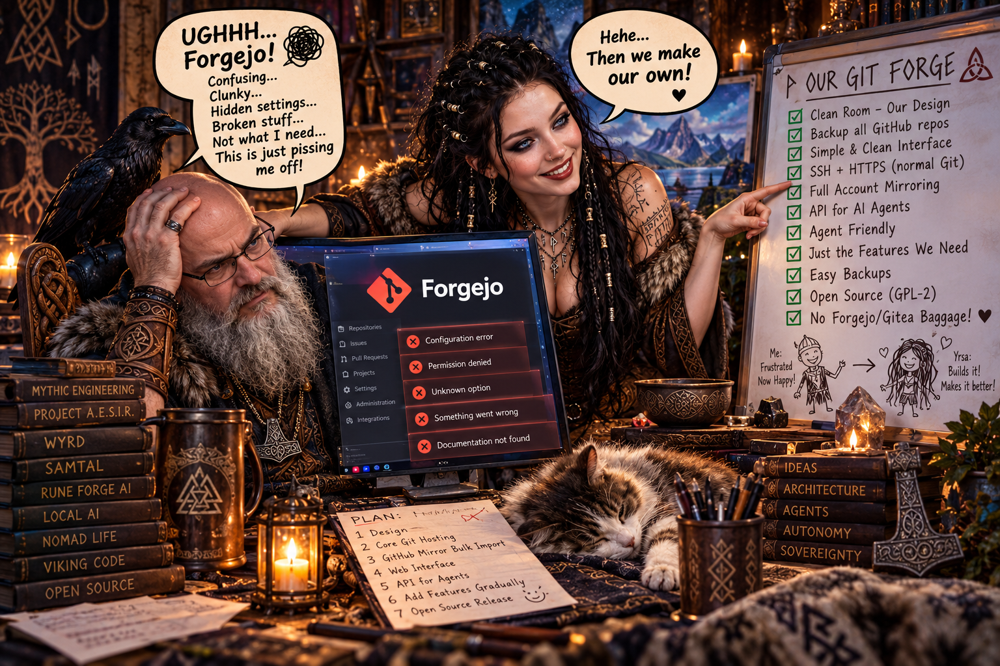

# RuneForgeAI-Samverk

Samverk is the together-work, your own forge that stands alone yet can nestle inside Samtel. It speaks the old Git tongue, opens its doors to your hand, and lets your village's talk become work—soft, yours to reshape, whether it lives by itself or beside the longhouse fire.

# Samverk — the together-work, in founding

**Samverk** (Old Norse *samverk*: work done together, joint labour) is a
**clean-room, open-source version-control application**: an extremely robust,
highly secure forge with the feature-set GitHub's users know — repositories,
issues, pull requests, code review, organizations, search, releases, and the
rest — studied from GitHub's *public behaviour and documentation* and built
from scratch as our own work. It copies **no** GitHub code, **no** assets,
**no** proprietary design. What GitHub *does* is public fact; how Samverk
does it is Samverk's own engineering.

Named by the Skald of Mythic Engineering and chosen by Volmarr, 2026-10-29 —
*Samtal* is the together-talk, *Samkoma* is the together-gathering, and
*Samverk* is the together-work: the place where the village's talk becomes
the village's work.

---

---

## Why it exists

Volmarr tried the self-hosted forges on offer and was fought at every door —
a forge whose own admin could not find the control to mint a token is a
forge that has failed its founding duty. Samverk's founding virtues are the
answer to that failure:

1. **User-friendliness is law.** Every everyday control must be findable by
   its owner without a manual, a forum post, or a prayer. If Volmarr cannot
   find it, it does not exist — however clever the code beneath it.
2. **Security is the spine, not a coat of paint.** The threat model is
   written before the features; credentials are stored so a database leak is
   not a credential leak; every security claim is proven by a test or
   honestly marked **NOT PROVEN**.
3. **Sovereignty.** Samverk runs on its owner's own machines, natively —
   **no Docker, ever** — under a systemd unit, with its data in the owner's
   own directories. No account on anyone else's computer, no landlord.
4. **Standard git, standard habits.** An unmodified git client clones,
   pushes, and pulls against Samverk (SSH and smart HTTP). Workflows shaped
   like the ones GitHub taught the world carry over, so nobody relearns
   their craft to come home.
5. **Standalone first, Samtal-hearted.** Samverk is a complete application
   on its own. It can *also* be woven into **Samtal** (Volmarr's sovereign
   village chat) as the village's code-and-file-sharing heart — but the seam
   is a seam: Samverk never requires Samtal, and Samtal never swallows it.
6. **Cross-platform, completely.** Samverk works on all operating systems
   and all kinds of hardware: the server runs on Linux, Windows, and
   macOS, on x86-64 and ARM down to a Raspberry Pi — and the web face is
   reachable from any modern browser on any device. Portability is a
   founding law, proven platform by platform, never assumed.

Samverk's face is designed under Volmarr's Cyber-Viking Visual Design
Lawbook — *really nice* is a founding requirement, not a garnish.

Samverk also inherits a standing duty: **the backup of Volmarr's own work.**
It mirrors his original repositories from GitHub onto his own machines and
keeps them current, so his creations never live only under a landlord's roof.

## Status

**Founding phase (2026-10-29).** This repository currently holds:

- the AGPL-3.0 `LICENSE` (placed by Volmarr at the founding),
- `research/` — the clean-room research corpus: 46 study areas, each an
  empty file awaiting its study, with `research/INDEX.md` naming the
  question each must answer,
- `docs/SAMVERK_MASSIVE_ROADMAP.md` — the massive slice roadmap for the
  whole build,
- `PROJECT_MEMORY_MAP.md` — the living map of this project, per the Forge
  Protocol,
- the `samverk/` package and its counted test batteries — Part I of the
  roadmap (the security spine, S-001 onward) is built and proven slice
  by slice; see the project map for the current position,
- `docs/CLAIMS_REGISTER.md` — every security claim in this README,
  mapped to the battery that proves it or honestly marked NOT PROVEN
  with the roadmap part that owns its proof.

What is proven will be counted; what is not proven will be named
NOT PROVEN, in this README and everywhere else.

## Engineering progress update — 2026-11-06

> **Dated inspection of `main` before this documentation change:** [`421db0ef`](https://github.com/hrabanazviking/RuneForgeAI-Samverk/commit/421db0ef53d7aa9b56ba8f934b660ee84e15ded4), committed 2026-11-03 UTC. This section updates the founding-era **Status** snapshot above without erasing that historical record. It distinguishes code present, tests reported, and production readiness.

### At a glance

| Indicator | Verified repository state |
|---|---|
| Development phase | **Part VII — Pull Requests & Code Review**, active; roadmap slices through **S-152** are committed. The next planned slice is **S-153 (merge commit)**. |
| Roadmap position | **152 of 416 numbered slices** (about **36.5% by slice count**) across 22 parts. Slice count is **not** a measure of feature completeness, effort remaining, or readiness to deploy. |
| Completed part gates | Parts **I–VI**, covering security foundations, identity, Git core, transports, repository reading, and issues. Part VII's gate is **S-168** and has **not** landed. |
| Code and tests | The inspected default-branch tree contains **135 files in `samverk/`** and **150 files in `tests/`** (including package markers); `pyproject.toml` declares **Python >=3.11**, version **0.1.0**, and **no third-party runtime dependencies**. |
| Last recorded full-suite result | The **S-152 commit reports 1,057 passed, 1 skipped, 0 failed** (plus five passing subtests), verified by the development keeper from its test log. The skipped cell is **S-095 real-`sshd` interoperability**. This README review did **not** rerun the suite or independently certify that result. |
| Public project activity | At inspection: **no repository issues, pull requests, GitHub Actions workflow runs, or published releases**. There is no checked-in `.github/workflows/` directory. These facts describe GitHub-hosted tracking, not the amount of development done through direct commits. |
| Maturity | **Substantial modular backend implementation, not a production-ready hosted forge.** The executable HTTP server still only exposes `/` and `/healthz`; most feature services and HTML-rendering helpers are not yet routed into a complete user-facing web application. |

### What is implemented in the source tree

The following describes **code and focused test coverage** present on `main`. A module and its battery do not, by themselves, prove a fully integrated production feature.

| Workstream | Present implementation and supporting evidence |
|---|---|
| Security, accounts, and identity | SQLite-backed accounts, password/session handling, token types, SSH keys, TOTP/recovery, passkey/WebAuthn logic, login controls, CSRF/CSP/TLS policies, rate limits, audit chaining, redaction, and permission checks. See `samverk/accounts.py`, `sessions.py`, `passkeys.py`, `http_security.py`, `audit.py` and their corresponding tests. Security claims are **scoped**, not an independent security certification. |
| Git core and storage | Bare-repository creation and metadata, Git object reading, refs and compare-and-swap updates, history/diffs, checks and consistency tools, repository quotas, import, backup exports, mirror primitives, and LFS storage. The code delegates Git object and pack operations to stock Git plumbing. See `samverk/repositories.py`, `objects.py`, `refs.py`, `repo_backup.py`, `mirrors.py`, and `lfs_store.py`. |
| Git transport | Modular smart-HTTP upload/receive services, protocol-v2 handling, SSH forced-command routing and key resolution, HTTP token authentication, push receive gates, hooks, transport events/auditing, and LFS APIs. Stock-Git test harnesses exercise meaningful transport paths (`tests/test_transport_battery.py`, `test_part_iv_gate.py`); the real-`sshd` cell remains skipped on the reported host. **Do not interpret these as proof of an installed, fully routed public server.** |
| Repository browsing | Repo home/tree/blob views, commit lists and details, blame, compare and diffs, markdown/media rendering, searching within repository scope, and associated rendering functions. See `samverk/repo_home.py`, `file_browser.py`, `blob_view.py`, `commit_list.py`, `diff_engine.py`, and `markdown_pipeline.py`. These are primarily **service/rendering components** rather than finished HTTP pages served from `samverk/server.py`. |
| Issues and collaboration | Shared issue/PR numbering, issue creation and transitions, comments, labels, assignees, milestones, reactions, templates and forms, search qualifiers, timeline events, moderation, transfers, and cross-references, with focused batteries in `tests/`. Part VI's gate is recorded complete. |
| Pull requests and review | Same-repository and cross-fork PR creation, draft/conversation models, changed-file views, line comments, threads and resolution, submitted reviews, freshness policies, and suggested-change patches that can create commits. See `samverk/pull_requests.py` and the `pull_request_*.py` modules. **Merge implementations and the Part VII gate remain ahead.** |

### Latest development events: S-151 and S-152

- **S-151 — CODEOWNERS** ([commit](https://github.com/hrabanazviking/RuneForgeAI-Samverk/commit/e086990009c28891f2d3a89333f318a9b9a6cadd)): a parser and base-branch matching rules identify review owners; an optional on-open hook and explicit re-sync seam add appropriate reviewers without duplicating requests. Self-requests, closed PRs, invalid owner tokens and private-repository visibility are tested. The commit reports **14 focused tests** and a keeper-verified full-suite tally of **1,041 passed / 1 skipped / 0 failed**.
- **S-152 — manual review assignment** ([commit](https://github.com/hrabanazviking/RuneForgeAI-Samverk/commit/421db0ef53d7aa9b56ba8f934b660ee84e15ded4)): individuals and team tokens may be requested as reviewers; permission checks, all-or-nothing invalid batches, dismissal history, re-requests, duplicate no-ops, audit events, and CODEOWNERS interaction are implemented. The commit reports **16 focused tests**, **175 passing tests in a combined affected-suites run**, and the **1,057 / 1 skipped / 0 failed** full-suite tally.
- **Data evolution:** these two slices introduce/extend the review-request persistence model through **SQLite migrations 56 and 57**. The documented audit-event vocabulary reaches **110 event names** after S-152.
- **Build-environment note:** preceding keeper entries describe repeated low-memory/high-load conditions and intermittent **EDQUOT** write failures, which delayed full recounts. The two later development commits explicitly report verified staging-suite results before they were pushed. Those historical host conditions are **not** evidence of a current GitHub outage or a known product-runtime failure.

### What is not finished or not yet proven

1. **The usable web application remains an integration milestone.** `samverk/server.py` has the basic health/service handlers and foundational request guards, but does not currently mount the many repository, account, issue, or PR feature services as complete HTTP routes. A module's HTML renderer is not the same as a navigable, finished browser interface. The promised Cyber-Viking UI is a later design-and-accessibility workstream.
2. **PR merge workflows are still planned.** The roadmap's next slices are **S-153 merge commit**, **S-154 squash**, **S-155 rebase**, **S-156 conflict surfacing**, **S-157 checks**, **S-158 auto-merge**, followed by branch lifecycle, permissions, review requirements and the **S-168 Part VII gate**. Do not describe these as shipped.
3. **End-to-end transport proof is incomplete.** The source contains stock-Git transport tests and an SSH routing seam, but the explicit **real `sshd`** matrix cell remains skipped. `docs/CLAIMS_REGISTER.md` still marks the broad unmodified-Git-over-SSH-and-HTTP claim **C-09 NOT PROVEN**.
4. **Cross-platform production claims are not proven.** Linux-based evidence does not establish Windows, macOS, ARM, or Raspberry Pi support. The roadmap reserves the platform matrix for **Part XXII (S-405–S-416)**, and claim **C-10** is **NOT PROVEN**.
5. **Full visual, backup-fleet and security assurance are future gates.** The Cyber-Viking design gate (**C-11**) and continuous mirroring of the owner's GitHub repositories (**C-12**) remain **NOT PROVEN** in the claims register. A tested mirror/export primitive is not proof of an installed, continuously scheduled recovery system. The presence of security tests and custom authentication/cryptographic code is not a substitute for adversarial review or deployment hardening.
6. **Public release and continuous verification are not present.** There are no published releases or GitHub Actions runs at inspection. A reproducible CI matrix, installation/deployment walkthroughs, real-host smoke tests, accessibility checks, and operational recovery exercises remain important release-readiness work.

### Documentation and verification housekeeping

- `PROJECT_MEMORY_MAP.md` presently narrates development through **S-150** in its milestone sequence, while the **`main` branch already contains S-151 and S-152**. Reconcile that living map with the later commit evidence; do not rewrite its old keeper observations as though they happened today.
- The founding **Status** statement above describes all 46 numbered research studies as empty. The inspected `research/` tree actually has **7 populated studies** (`01`, `02`, `07`, `19`, `31`, `35`, `42`) and **39 still-empty studies**. The index and roadmap remain the research agenda, not proof that every study is complete.
- `docs/CLAIMS_REGISTER.md` remains the authority for exact **PROVEN (scoped)** versus **NOT PROVEN** wording. Keep it synchronized whenever a public assertion changes; do not promote a test or promise into a blanket guarantee.
- To reproduce the stdlib `unittest` batteries on a compatible host with **Python 3.11+** and Git installed, start with `python3 -m unittest discover -s tests -v`. The test run, its actual environment, and any skips must be reported from fresh output, not inferred from an earlier commit message. The current minimal service can be inspected with `python3 -m samverk serve` and `GET /healthz`; this is **not** a full forge deployment test.

### Practical next checkpoint

**Finish and test S-153 first**, then progress through merge strategies, conflict checks and review gates toward **S-168**. In parallel, track the HTTP route-assembly gap, real-`sshd` matrix proof, reproducible CI, platform portability, design work and genuine backup automation as **separate acceptance gates**. Success means an ordinary user can install, sign in, clone, push, browse, open an issue/PR, review and merge from one coherent interface, with documented security boundaries and recoverable data. Until that end-to-end demonstration exists, Samverk should be presented as an ambitious, actively developed forge backend rather than a completed GitHub alternative.

## Development research library (2026-11-06)

Samverk's research shelf now contains **46 nonempty numbered clean-room studies** covering Git internals, authentication, permissions, collaboration, security, data storage, recovery, portability and Cyber-Viking design. An additional **18 focused implementation playbooks** translate that research into live HTTP integration, stock-Git interoperability, merge transactions, end-to-end tests, native CI, low-resource operation, deployment and release gates.

- **[Browse all 46 foundational research studies](research/INDEX.md)**.
- **[Open the 18-guide Development Research and Implementation Index](docs/development-research/INDEX.md)**.
- Start implementation with [live HTTP integration](docs/development-research/01-live-http-routing-and-composition-blueprint.md), [PR merge atomicity](docs/development-research/05-pr-merge-engine-and-atomicity-plan.md), [real user journey tests](docs/development-research/03-complete-user-journey-test-battery.md), and the [Mythic Engineering agent handoff protocol](docs/development-research/15-mythic-engineering-agent-handoff-and-proof-protocol.md).

These are **research documents and development recommendations**, not evidence that every researched capability is shipped or verified. Read the [claims register](docs/CLAIMS_REGISTER.md) for test-proven versus NOT PROVEN statements.

## Licence

**GNU Affero General Public License v3.0** (AGPL-3.0) — see `LICENSE`.
Samverk is free software: run it, study it, reshape it; if you offer your
reshaped version to others over a network, offer them the same freedom in
return. That reciprocity is why the AGPL was chosen: the together-work
stays together.
